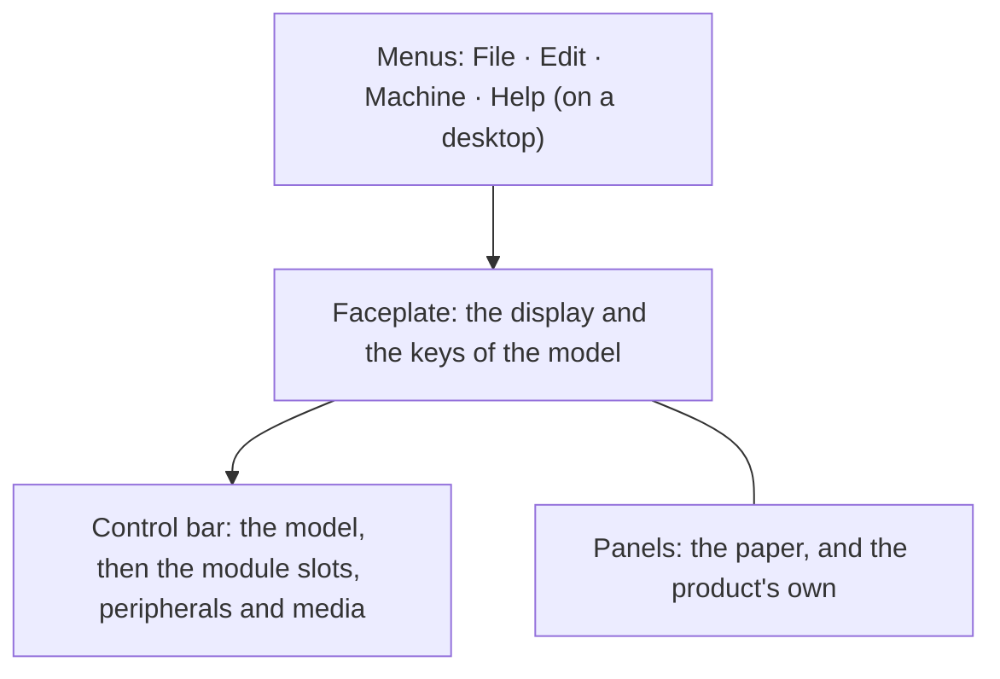

# Getting started

Every product of the Calc-U family has the same window: the faceplate of
the model you run, the control bar below it, a place for panels such as
the paper, and the menus File, Machine and Help, and Edit where the
product has it. This page shows
the parts all products share. What the faceplate and the keyboard of
your product look like is in [the product's part of this
chapter](chapter:2).

## The window

- **The faceplate** is the model as you know it: its display and its
  keys. Click or touch a key to press it.
- **The control bar** below the faceplate holds the machine's hardware
  (see [The control bar](#the-control-bar)).
- **The panels** show what a peripheral puts out, such as the paper of
  a printer ([Peripherals and paper](05-peripherals-and-paper.md)).

## The menus

The menus are the same in every product, in this order. An item for
which the product has no function does not appear, and a menu without
items does not appear. An item that cannot be used right now is shown
greyed out; where the platform shows tooltips, its tooltip says why.

| Menu | Items |
|---|---|
| File | Load Preset…; Examples ▸; the product's own kinds of files; the items for media (Import Media…, Saved Media… in the browser); Settings…; Quit |
| Edit | the product's items for the display and the clipboard, where it has them |
| Machine | Model ▸; a submenu for each thing that has variants; Peripherals ▸; Reset; Cold boot; Resume |
| Help | `<Product>` Help; About `<Product>` |

- **Load Preset…** opens a preset file, and **Examples ▸** lists the
  examples that come with the product, one submenu per group
  ([Presets](06-presets.md)).
- **Settings…** opens the settings dialog
  ([The settings dialog](#the-settings-dialog)).
- What the Edit menu holds, if the product has one, is in [the
  product's part of this chapter](chapter:2).
- **Model ▸**, the variant submenus, **Peripherals ▸**, **Reset** and
  **Cold boot** are described in [Models and machine
  control](03-models-and-machine-control.md).
- **Resume** lets a paused machine run on
  ([Debugger](07-debugger.md)).
- **`<Product>` Help** opens this help on calc-u.org in your browser.
  **About `<Product>`** shows the product's name, its version, its
  build and links to its source and to support.

On macOS, Settings…, About and Quit are in the application menu, as on
every Mac program. In the browser there is no Quit.

### Desktop and mobile

On a **desktop** (the desktop apps, the browser in a tab on a computer)
the menus are in the menu bar. On **mobile** (on the iPhone and the iPad,
the browser version installed on a phone or tablet, a browser that asks
for the mobile site) there is no menu bar.

On both, the control bar ends with the **More** button (⋯) at its right
edge. It holds the menus' items without what has a control elsewhere:
Load Preset…, Examples ▸, the items for media, Settings…, Reset, Cold
boot, which asks first there, Resume, Help, and About where the system
has one. Model ▸ is not in it (the model picker is on the bar), nor
Quit. An item that cannot be used now is greyed out there too.

### Shortcuts

On the desktop:

| Item | Windows, Linux | macOS |
|---|---|---|
| Load Preset… | Ctrl+O | ⌘O |
| Reset | Ctrl+R | ⌘R |
| Cold boot | Ctrl+Shift+R | ⇧⌘R |

A shortcut is taken before the key reaches the machine. In the browser
the menu items have no shortcuts, because these keys are the browser's
own.

## The control bar

The control bar holds the hardware of the running machine, from left to
right:

1. the model picker;
2. one picker for each module slot, with the slot's number before it
   when the model has more than one;
3. a control for each other place where a peripheral can go: a button
   with the peripheral's name when only one fits the place (press it to
   attach or detach), or a picker when several fit, whose empty choice
   names the place ("No printer");
4. the controls of each media place, such as a disk drive or a cassette
   ([Media](04-media.md));
5. the More button, at the right edge.

On mobile the bar keeps what you use while the machine runs: the model
picker, the module slots and the media the product names there. The
places' controls are in **More ▸ Peripherals ▸** (unless the product
shows them on a panel), and each other media place has a submenu in
More: its media to choose, then **Name & Save…**.

A model without such a place has no control for it, and no gap where it
would be. Which controls your product shows for each model is in
[the product's part of chapter 5](chapter:5).

## Loading…

While the product works at full speed for longer than half a second,
for example while it loads a preset, "Loading…" is shown with a sign
that work is going on. It blocks nothing: the display, the paper and the
control bar go on showing what changes, and the menus, the model picker,
Reset and Cold boot can still be used. Controls that would start another
operation are disabled until it is over.

## Notices

When something goes wrong or needs your attention, a notice tells you,
in a dialog with an OK button. The machine and a running operation go on
behind it. Several notices are shown one after the other, in the order
they came.

## The settings dialog

**File ▸ Settings…** (More ▸ Settings… on mobile) opens a dialog titled
"Settings". A change is
applied and kept at once; the only button is Close (Done on iOS). You can change
settings while an operation runs. The sections are:

| Section | What you set |
|---|---|
| General | Startup model: "Last used" or one of the models |
| Startup presets | for each model, a preset to build it from at a start |
| Storage | the save folder, and further folders of the product |
| Folders | the folder in which each file dialog starts |
| Tracing | the trace folder and the largest trace file, in MB |
| the product's sections | the product's own settings |

A row of a folder shows the folder in use, with `~` for your home
folder, a "Change…" button and a "Reset" button, which puts the setting
back to its default. A section is shown only where the frontend has one
of its settings. What each setting means is in [Settings](08-settings.md).

## Keys

You press the keys of the machine in these ways:

- **On the faceplate.** Click or touch a key. A click near a key, in the
  gap between two keys, presses the nearest one. You can hold several
  keys at once with several fingers.
- **On your keyboard.** A host key presses the key or keys the product's
  keyboard map gives for it. A character that needs several keys on the
  machine, such as a shifted character, is typed as those keys one
  after the other. Your keyboard's auto-repeat is ignored. The keyboard
  map of each model is in [the product's reference](chapter:10).
- **By the product's own ways**, where it has them, such as typing the
  text of the clipboard ([the product's part of this chapter](chapter:2)).

A key you press is held for at least the shortest time the machine
needs to see it, also when you let go sooner. When you hold two keys at
once, the machine sees both down together. When the window loses the
focus, every key you hold is let go.

While an operation runs (a preset loads, the machine is built), the keys
you press are not passed on.

### Speeding up

Press and hold the pointer on the display of the faceplate: the machine
runs at full speed while you hold it, and at regular speed again when
you let go or leave the display.
