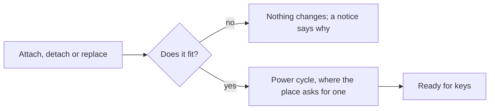

# Models and machine control

A product runs one machine at a time: one model, in one variant, with
the peripherals and media you put into it. This chapter shows how to
choose the model and the variant, how to reset it, and what
the product needs to start at all.

What a Reset, a Cold boot or a power cycle keeps is not the same on
every model. The product's [Product topics](chapter:9) say what each of
its models keeps.

## Choosing a model

Choose the model in the model picker at the left of the control bar, or
under **Machine ▸ Model ▸**, where the running model is marked.

A model switch builds a new machine of that model, as at a start of the
product:

- when a startup preset is set for that model, the machine is built from
  it ([Startup presets](06-presets.md));
- otherwise the product builds its own default machine for that model.

The machine you leave is gone with everything in its memory. What you
saved as a medium stays saved ([Media](04-media.md)). Text that was
still being typed, keys you held and full speed do not carry over.

Choosing the model that already runs does nothing.

## Choosing a variant

A model or a peripheral that comes in several variants, mostly ROM
versions, has a submenu of its own under **Machine**, with the running
variant marked. The product gives each submenu its name.

- **A variant of the model.** The machine is built again in that
  variant, with the same peripherals in the same places and the same
  media in them. Its own memory starts empty, and no startup preset is
  loaded.
- **A variant of a peripheral.** The peripheral is replaced by the same
  one in the other variant, in one step, as when you attach a
  peripheral ([What follows a change of hardware](#what-follows-a-change-of-hardware)).

The submenu of a peripheral is shown only while it is plugged in.

## Reset and Cold boot

**Machine ▸ Reset** restarts the machine and keeps its memory, as far as
the model does. **Machine ▸ Cold boot** starts it as after the batteries
were out for a long time: all memory is empty, on every model.

| | Reset | Cold boot |
|---|---|---|
| Memory | kept, as the model keeps it ([chapter 9](chapter:9)) | empty |
| Peripherals and media | stay plugged in and inserted | stay plugged in and inserted |
| Text being typed, keys held | dropped | dropped |

Both end when the machine is ready for keys again. A machine with a
real-time clock gets your computer's date and time afterwards.

Reset, Cold boot and a model switch can be used while an operation runs,
such as a preset that loads: the operation is stopped first. Every
other change to the machine waits until the operation is over.

## What follows a change of hardware

When you attach or detach a peripheral, or plug in a module, the machine
does what the real one would: for most places it goes through a **power
cycle**, as if you had switched it off and on, so that its ROM finds
what is plugged in now. The change is over when the machine is ready for
keys again.

Replacing one peripheral by another (choosing another module in a slot's
picker, another printer in a picker) is one step with one power cycle.

What the memory keeps through a power cycle depends on the model
([chapter 9](chapter:9)).

## The startup model

When the product starts, it builds the **startup model**: the model you
chose as Startup model in the General section of the settings dialog, or with "Last used"
the model that ran last. The model that ran last is the one of the last
machine built, by the model picker, the menus or a preset. On the first
start the product chooses a model of its own.

A startup preset set for the startup model is loaded at the start
([Settings](08-settings.md), [Presets](06-presets.md)).

## ROMs

Each model and each peripheral with a ROM needs its ROM files. A
release brings every one of them: the full set for every model, variant
and peripheral of the product. You never have to look for a ROM, and
nothing is ever refused while the product runs because a ROM is
missing.

When a file of the full set is missing or damaged, which can happen in
a build of your own before the ROMs were fetched, the product starts no
machine. In place of the faceplate it shows which files are missing or
bad, and that the full set is needed. There is no control bar and no
Machine menu then; Help and About still work.
