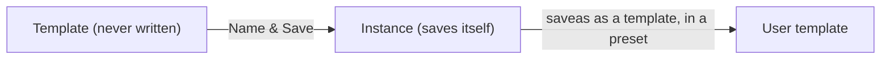

# Media

A **medium** holds your data and can be named and saved: a memory
module that keeps its contents on a battery, a disk, a cassette or a card. Which media your product has, and where each goes, is in
[the product's part of this chapter](chapter:4).

## Templates and instances

Every medium is a template or an instance.

- A **template** is a starting point. The product brings its own, and
  you can make your own (a user template). A template is never written:
  what the machine writes to it stays in the machine until you save it
  under a name, or until you take it out.
- An **instance** is a medium of your own, with a name. It saves itself
  after each change (autosave), at the latest half a second after the
  machine wrote to it, so there is no Save command to remember.

Each medium carries its name inside its file. The file's name counts
only for a file that carries none.

A template can carry an **insert notice**, something you need to know
before you use the medium. It is shown when you put the template in
(from its place's picker, by Start new, or by opening or dropping its
file). A medium you saved from it keeps the text but no longer shows it,
and a preset that puts the template in shows nothing.

## The save folder

Your instances and user templates live in the **save folder**. You
choose it in the settings dialog, under Storage
([Settings](08-settings.md)). In the browser, media are kept in the
browser's storage, from one visit to the next.

A medium's file is named after the medium, with the ending of its kind.
When a file of that name already holds another medium, the new one gets
the next free numbered name (`name-1`).

The product reads the save folder again whenever it wrote to it and
whenever you open a picker or the list of saved media. It does not
watch the folder for changes made by other programs.

## Choosing a medium

The picker of a module slot, or of a place that holds a medium (a disk
drive, a cassette), lists in this order, each group sorted by name:

1. the empty place;
2. the templates, the product's before your own;
3. your instances;
4. in a module slot, the modules that are not media (a ROM module, for
   instance).

The tooltip of an entry is its description.

When you choose an entry, anything the old medium still has to save is
saved first. A disk or a cassette is in at once. A module is a change of
hardware, so the machine goes through a power cycle
([What follows a change of hardware](03-models-and-machine-control.md#what-follows-a-change-of-hardware)).
A medium that cannot be read leaves the place empty, and a notice says
why.

## Name & Save

Use **Name & Save** on a place whose medium is not an instance yet: a
template the machine wrote to, for example a fresh disk you formatted.
It asks for a name, and, where the medium has a write-protect switch
that is still off, whether to switch it on. The medium is then saved as
your instance, stays in its place without a power cycle, and saves
itself from then on.

A name has these rules:

- spaces around it are dropped, and runs of spaces become one;
- it may not be empty, and may not hold `/ \ : * ? " < > |`;
- two names that differ only in upper and lower case are the same name.

Name & Save refuses the name of a medium the product brings, the name
of a user template, and the name of an instance that is in another
place right now. For the name of an instance of yours it asks before it
replaces it.

When you switch the write-protect switch on with a save, the medium is
protected at once and the machine goes through a power cycle, as when a
module is plugged in. No control switches it off again.

Where a place starts a new, empty medium (a cassette you record onto, for
example), it asks for the name first. That is Name & Save done up front:
nothing is written until the machine writes the first time.

## Insert and eject

A disk or a cassette is inserted by choosing it in its place's picker and
ejected by choosing the empty place or the eject control. What is in a
place stays there across a Reset and a Cold boot. Before a medium leaves
its place, before a preset loads, before the machine is replaced and
when the product quits, anything not yet saved is saved.

If a save fails, a notice says so, once for that medium until a save of
it succeeds again; the next change tries again.

## Files that cannot be read

A file of a medium's kind that cannot be read (it is broken, or it is in
another version of its format than the release reads) is not listed in a
picker; the log says once why. A preset that names it is refused with
that reason, and so is opening or importing it. Files written by an
earlier release are converted by hand, as
[the product's part of this chapter](chapter:4) describes.

## Opening and dropping files

There are several ways to hand a file to the product, and all of them
do the same thing:

- drop it on the window;
- open it with the product from your file manager (Open With);
- name it when you start the product;
- choose it in **File ▸ Load Preset…**, which offers presets only, like
  every item that loads one kind of file (in the browser also the files a
  preset names, see below).

A drop takes one file: a drop of several files is ignored. On the
desktop, a file you drop or open with the product brings the window to
the front.

The product looks at the file and opens it as what it is:

| The file is | What happens |
|---|---|
| a preset (by its ending, or a text with a `model:` line) | it is loaded ([Presets](06-presets.md)) |
| a medium (by its ending) | it goes into its place (below) |
| a program or another kind of file the product knows | the product's handling of that kind ([chapter 9](chapter:9)) |
| anything else, or too large | refused, with a notice that names the file and says why |

A medium you open is used where it lies: nothing is copied, and what the
machine writes is saved back into that file, unless the file says it is
a template. It goes into its place at once, with its first side up, and
a medium that was there is ejected first. A module is plugged in when it
is clear where it goes: the model has one module slot, or the module
fits only one of them. Otherwise, and when the medium's place is not
there now, a notice says where such a medium is chosen.

In the browser an opened file cannot be written back, so a medium is
first imported into the save folder ([Saved media](#saved-media)).

The browser cannot look into the folder a preset lies in, so a preset
brings only the files chosen with it. In **File ▸ Load Preset…**, pick
the preset together with every file it names (its tape, card, disk,
module or program files); the dialog offers those kinds of files too.
They are taken as one folder, the preset among them is opened, and a
file it names is found by its name alone, whatever folder the preset
gives. A file it names that was not chosen is refused with a notice that
names it.

A file you open while an operation runs, or before the product has
finished starting, is kept and opened as soon as the product is free.

While you drag a file over the window on the desktop, the pointer shows
whether the product would take it.

## Saved media

In the browser, the File menu (and the More button) has two more items:

- **Import Media…** copies a medium file into the save folder, as the
  template or instance it says it is. An import is refused when a medium
  of that kind already has the name, and when the file cannot be read.
- **Saved Media…** lists your media by kind and name, marks templates
  and the media that are in a place now, lets you save a copy of a
  medium's file, and deletes one that is in no place, after you
  confirmed.
