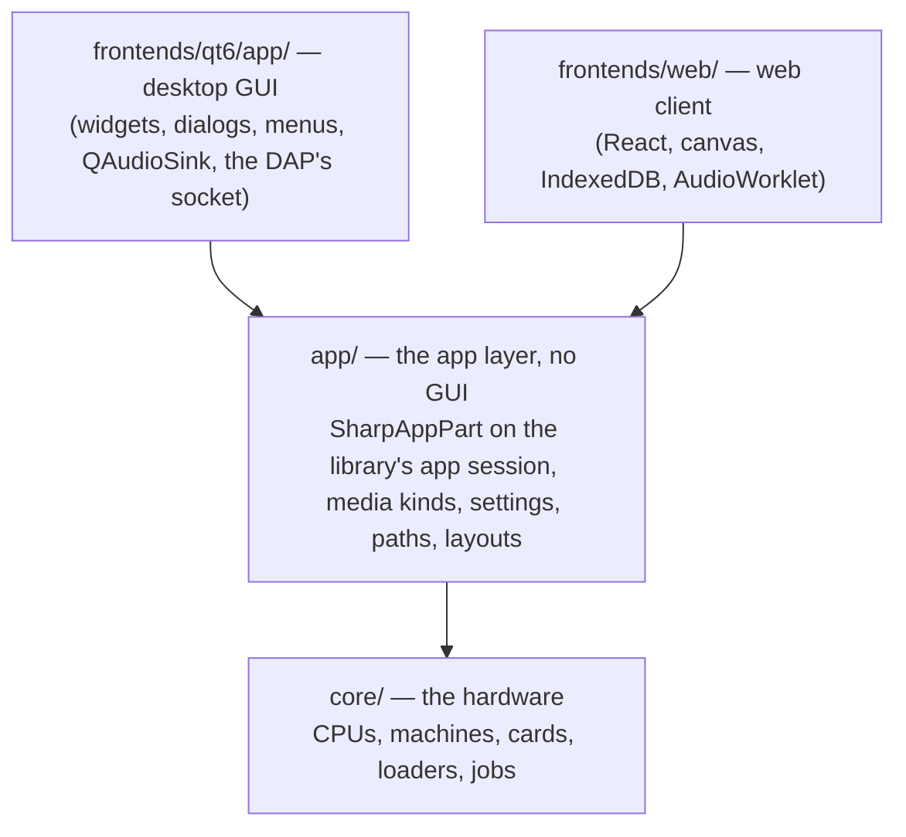

# App layer: core, app layer, frontends

Calc-U-1600 is built in three layers, so the desktop app and the
WebAssembly client ([Web-Client.md](Web-Client.md)) run the same emulator
and the same app logic:

- **`core/`** is the emulated hardware and what drives it: CPUs, machines,
  cards and connectors, program loaders, the debugger core. Presets are
  the library's (`library/presets/`).
- **`app/`** is everything above `core/` that is not drawing: the product's
  part of the library's app session (the live machine and its operations,
  the media kinds of the library's media part), the pacing profiles, settings keys, file
  locations, and the layout numbers renderers draw with. The session
  itself -- operations, busy, pacing, sound policy, messages -- is the
  library's (`library/sessions/`, `library/pacing/`).
- **A frontend** keeps widgets and painting, dialogs, menus, settings
  storage, the audio device, the debugger transport and packaging.

Both libraries are built by [`cmake/CalcU.cmake`](../../cmake/CalcU.cmake)
(`calcu_core`, and `calcu_shared` for `app/`: the target keeps its old
name) for the Qt app, the harness, the tests and the WebAssembly check.

## Rules

- **Non-GUI logic goes in `app/`.** A frontend translates types only
  (QString ↔ `std::string`, Qt keys → `calcu::typing::HostKeyEvent`, pixel buffers →
  QImage) and shows what the app layer decides.
- **Portable C++20, standard library only.** No Qt, Cocoa or Emscripten
  headers in `core/` or `app/`. Paths are UTF-8 `std::string`s converted
  through the library's `files/Files.hpp` (`calcu::files::toPath`, `fromPath`; Windows code pages).
- **Single-threaded and never blocking.** Everything runs on the
  frontend's one thread. Long machine work (a boot, a preset, a typed
  program, a power cycle) is a resumable job (below), never a blocking
  loop with a yield hook. There is no threaded mode (Calc-U-59 2.3.0's app
  layer had one).
- **The app layer never decides where files live.** The frontend hands it the
  host's folders (`calcu::settings::HostDirs`: home, the settings base of its
  platform, on the Web the save folder) and the bundled-resources folders
  (`cu1600::BundleDirs`), and opens the settings file, `Calc-U-1600.ini`
  (`calcu::settings::SettingsFile` at `settingsFilePath()`); the
  library's `calcu::settings::Paths`, `cu1600::AppPaths` and
  `cu1600::Settings` (the declaration of every key, `settingsDecl()`) do the
  rest. No frontend keeps a setting in QSettings or `localStorage` (CTest
  `CalcU1600NoPlatformSettings`).
- **Messages for the user** come back as English sentences (the app has no
  translations).

## The pieces

| File | What it is |
|---|---|
| `SharpAppPart` | Calc-U-1600's part of the library's app session (a `calcu::sessions::SessionPart`): the live PC-1500/1500A/1600 as one `calcu::machine::Machine` handed to the machine session, memory-module slots, peripherals, tape, host drive, trace, inspector; the library's parts it hosts: `MediaPart` (the media); `PresetsPart` (`load-preset {ref \| content,name; buildOnly}`, `check-preset`, `preset-list`, `run-step`, `wait-idle`) and `StartupPart` (`start`, `model {name}`, `variant {name}`, `attach {place, peripheral, variant?}`, `detach {place}`, `reset`, `cold-boot`, `power-cycle`); the library's media commands (`media.choose`, …), the product commands `c1600.mount-host-drive`, `c1600.ce1600p-variant` (each a plug change of the library's machine control); the product topics `c1600.lamps` (the tape counter, the floppy lamp) and `c1600.serial-links` (`SharpTopics.hpp`; `roms-missing` is the `StartupPart`'s); the rules of the control state (`SharpControlRules`) and the library's `ControlPart`, first in the one order of `LibraryParts::sessionParts` (see "The machine" below). `SharpAppPartOptions`: `canMountHostFolder` (the Web says no), `uploadFolder` (the Web's uploads folder, where several files of Upload Preset… become one folder) |
| `SharpDebuggerSetup`, `SharpTraceRecorder`, `SharpSymbolReaders` | The library's debugger for the Sharp models: the `DebuggerPart`'s set-up (`cpu` only, the trace session on the core's records, no run-control steps), the trace records into the trace file, the symbols of the Sharp listings |
| `SharpPrinters` | The CE-150's and the CE-1600P's papers for the library's `PaperPart` |
| `dap/` | The DAP server (`cu1600::dap`; every native tree, not Emscripten): `DapPart` (a session part: listening, the topic `c1600.dap`, held messages), `DapSession` and `DapSetup.cpp` (the requests, the set-up as operations, the events), its targets, breakpoints and steps on the library's debugger; JSON, framing and `DapTransport`, which a host fills (Qt6: `frontends/qt6/app/debug/DapSocket`; the harness: `serve --dap` on `library/harness/attach/LocalStream`) |
| `SharpTyping` | Typing on the library's typing engine (`library/typing/`): the typing profile per model (`typingProfile`: 4 + 4 frames, 6 more after SHIFT and KBII on the PC-1600, readiness rules, the characters, the `key` names), the keyboard map per model (`SharpKeyboardMap`), `typingProduct()` for the session's `TypingPart` |
| `SharpSession` | `makeSharpSession()`: the library's app session with the control part and the part, which the session owns (on the library's `calcu::shell::makeHostSession`: `SharpSessionOptions` is its `HostSessionSetup`; Qt6 with the library's `SettingsPart` over `AppPaths::folders()`, tests, `tools/wasm_smoke`; the Web engine calls the builder itself); a host talks to it through the library's `calcu::sessions::Listener` (Qt6: the Qt6 component set's `SessionHost`) |
| `SharpControlRules` | The product's side of the library's control state: the place `host-drive` not available where no folder can be mounted, and the product entries `c1600.disk-controls`, `c1600.ce158-printer-panel`, `c1600.host-drive-folder`, `c1600.mount-directory`, `c1600.ce1600p-next-variant`; `SharpAppPart` gives it to `LibraryParts` as the `ControlPart`'s rules (its catalogue and printers, CE-150 and CE-1600P, are `LibraryParts`', from the papers). Everything else of the old `ControlState` is the library's generic entries, from the descriptors (one pin-out per 60-pin place) |
| `SharpShellProduct` | What the product gives the library's shell, one source for Qt6 and the Web: `shellProduct()` (name, help address, About texts, variant labels, the product's File items), `faceplateHitMap()` (the hit map of `KeyLayout`, distance 24), `settingsSpec()` (the dialog's sections, the product's Folders labels, Serial ports, Debugger); their Value forms for the page are the library's (`shell/ValueForms`), `faceplateMapValue()` adds the art's size and the LCD layout |
| `SharpWebPart` | What only the Web page asks for (the page is the React set's shell): `c1600.shell-product`, `c1600.faceplate-map`, the INSPECTOR's requests, Copy Screen's picture, the stream `c1600.printer`; with the CMake option `CALCU_WEB_TEST_AIDS` (not in a release Web build) the Web tests' `c1600.upload` and `c1600.display-text` |
| `SharpMediaKinds` | The three kinds of medium of the library's `MediaPart`: the battery-backed module (`.module.yaml`), the floppy disk (`.floppy.yaml`, version 2) and the cassette (`.cassette.yaml` with its WAV), their codecs, which module fits which slot; the media part keeps the pickers, Name & Save, `saveas:`, autosave and the saved media |
| `SharpPresetRules`, `SharpPresetKeys`, `SharpDebugBlock` | The product's part of the library's preset loader: its rules per model (when the machine is idle, what `expect:` reads, what `screenshot:` writes), its keys and sections (`program:`, `host-drive:`, `slot-N-rom:`, `bus-rom:`, `debug:`), and the reader of the `debug:` block (`debugBlockOf`). The bundled presets are the library's preset list from `examples/bundle.yaml` (`SharpAppPart::presetEntries()`, the `preset-list` request); a bundled example is addressed as `examples:<path>` |
| `SharpProductMachines` | The machines for the library's start, model and variant switches and plug changes |
| `PacingProfiles`, `AudioSink` | The Sharp pacing profiles (the slice is the call, no jitter, full speed never paced); the host's audio output and `SoundFeed`, which plays the session's sound messages into it |
| `Settings`, `AppPaths` | Every settings key with its default (the declaration of `Calc-U-1600.ini`); the save/tapes/bundle folders and by-name save paths |
| `KeyLayout/`, `LcdLayout`, `Rgb` | Key hit-regions and the faceplate fit, by `ModelId`; LCD geometry, colours and status indicators (`lcd::indicatorSlots()`, the table the Web lays out by too, and `lcd::indicators()` of a display output) |
| `SharpLoaderPart` | The loaders in the session: `c1600.file-kind` (what a file is, a WAV's files), `c1600.load-basic`, `c1600.type-basic` (an operation), `c1600.code-plan` (the one plan, asked again as the address is typed), `c1600.load-code` (the load and its advice; an operation with `run`); stateless, each call carries the file. The harness has it too (`c1600 file-kind`, `load-basic`, `type-basic`, `load-code`) |
| `SharpFileKinds` | Opening a file: a drop, Open With, the file named at the start and Load Preset… send the library's `open` (the `OpenPart` that `SharpAppPart` owns, after the loaders among the parts), and the drag `open-would-take`. The library tells presets (`.pc1500`, `.pc1500a`, `.pc1600`, a `model:` line) and media by their names; `BasicProgramKind` and `MachineCodeKind` take the rest by the loaders' classifier (headerless code only in a `.bin`). A program file opened by a way with a window is the stream topic `c1600.program-opened`, on which the frontend runs its program flow; in the harness it is loaded at once. The limit is 1 MiB for a drop, Open With and the start argument. The library's `opening/StartFile` picks the file named when the Qt6 program starts |
| `ModuleYamlDump` | The INSPECTOR's Module YAML: each slot's module RAM as an `initial-content:` block |
| `Text` | Small string helpers |

## The machine

`SharpAppPart` builds the live machine and hands it to the library's
machine session (`MachineSession::setMachine`, with its pacing profile),
which owns it (the library's machine interface, `library/machine/`). Nothing in `app/` or a frontend names
`PC1500Machine` or `PC1600Machine`: the CTest `CalcU1600MachineIncludeCheck`
(`tools/check_machine_includes.sh`, Frequent and CI) fails the build when a
file in `app/`, `frontends/`, `tools/` or `dev/` includes or names one.

- **Building.** `calcu::machine::build(catalogue, SharpMachineBuilder, request)`
  with a copy of `sharp::sharpCatalogue()` (the models, CE-150, CE-158,
  CE-1600P, host drive) to which the module definitions are added
  (`sharp::addModuleDefinitions`, `moduleDescriptor`; the CE-502B's from
  the ROM set). The ROM images come from the session's ROM set: one
  lookup when `SharpAppPart` is made (`sharp::lookUpRoms`,
  `core/Machine/SharpRoms`) over the bundled resources folder,
  then `RomSet::imagesFor()` for every build and attach. Without the full set no machine is
  built: the `start` command is refused with the lookup's message and the
  `roms-missing` topic carries it. Every rebuild is then a `coldBoot()`.
- **Operations and keys.** `reset()`, `coldBoot()`, `powerCycle()` (the
  off / on sequence now runs inside the core, `core/Machine/PowerCycleSequence`),
  driven by the library's machine control until the machine is ready for keys. Keys are key IDs
  (`keyDown`/`keyUp`; `on` is one of them). Typing (holds, gaps, key
  readiness, Paste Text) is the library's typing engine; the machines offer
  the generic kind `typing-support` (prompt readiness; on the PC-1600 the
  SHIFT and KBII latches).
- **Peripherals** are `attach`/`detach`/`replace` in the places `slot-1`,
  `slot-2`, `printer`, `interface`, `host-drive`; a change on a running
  machine reaches the bus at the off point of the power cycle that follows.
  The CE-1600P with the CE-158, or a second printer, is refused with a
  sentence.
- **What only a Sharp machine has** is a capability: the product kinds
  `c1600.loader-memory`, `c1600.inspector`, `c1600.ce158-printer-port`,
  `c1600.host-drive-folder`, `c1600.trace-records`, `c1600.program-state`,
  and the adapter kinds
  `c1600.tape-deck`, `c1600.floppy-drive`
  (`core/Machine/SharpProductKinds.hpp`); the library's `serial-port`,
  `real-time-clock`, `controls` (the CE-161's write-protect switch) and
  `paper-output` (the plotters, `core/Connector/PlotterPaperOutput.hpp`);
  the debug targets are the machine's `debugging()`
  (`core/Debug/SharpDebugging`). The program loaders reach memory only
  through `c1600.loader-memory` (`core/Loaders.hpp`).
- **Serial ports and clock.** The library's peripherals session part
  (`calcu::peripherals::PeripheralsPart`, listed before `SharpAppPart`)
  holds the `HostLinks` (the pseudo-terminals, `calcu1600-rs232c.serial`,
  `calcu1600-ce158.serial`), pumps them before and after each host call and
  sets the real-time clocks from the host at a new machine and at the end
  of every operation.
- The machines hold no lock and start no thread; the host links'
  own reader and writer threads touch only their rings.

## How a frontend drives it

A frontend hosts the library's app session and talks to it by
messages: it sends commands and requests, and keeps what the topics send.

1. Open the `SettingsFile`, build `Settings` over it and `AppPaths` (with
   its `HostDirs` and `BundleDirs`), then the session with
   `makeSharpSession()` (or, like the Web engine, the part and the session
   by hand: the part's `sessionParts()` in the `AppSessionSetup`, the part
   in its `owned`), and listen with a `calcu::sessions::Listener`, stating
   the frontend's host services (an audio sink; a folder picker offers
   File ▸ Host Drive…).
2. Send `start` (the `StartupPart`): the startup model (or the one
   named), cold booted, then its startup preset or the preset named; a
   startup preset that can't be loaded gives the built-in default machine
   and a notice -- an operation.
3. Call `session().call(now)` from a ~60 Hz timer. The library's pacer
   runs the machine at the speed last commanded (`speed {full}` while the
   display is held), or one part of the running operation; the parts do
   their per-call duties (autosave, tape); the topics that changed go out.
   Repaint from the `display` topic (`displayFrameOf`, `lcd::indicators()`).
4. Send keys as the library's typing commands: a host key as
   `host-key-down` / `host-key-up` with what the host reported (the
   product's keyboard map in the session decides), an on-screen key as
   `screen-key-down` / `screen-key-up`, Paste Text as `paste`, focus loss
   as `focus-lost`. Keys pressed while an operation runs are dropped.
5. Start operations with their commands (`load-preset`, `reset`, `cold-boot`, `model`, `variant`, `attach`, `detach`, the
   library's `media.choose`, …; `SharpTopics.hpp`). The reply comes when the operation ends; the `busy`
   topic says it runs and whether at full speed ("Loading…"). A failure is
   also a notice. Reset, Cold boot and a model switch stop a running one.

The Qt app does this through the Qt6 component set:
`MachineController` makes the session and a `calcu::qt6::SessionHost` over
it (both in a `calcu::qt6::ProductHost`; the host folders and the settings
file are `calcu::qt6::HostFolders`, `AppPaths::folders()`), which hosts it on the GUI thread (a 60 Hz timer, one host call per
tick, the listener, the host services, harness attach in development
builds); `MainWindow` is put together from `calcu::qt6::Shell`, which draws
the menus, the control bar, Settings, About, the notices, "Loading…" and
"ROMs missing" from the topics and sends the library's commands, and keeps
the product's: the faceplate and LCD, the media controls of the bar
(`MediaControls`), the INSPECTOR and the CE-158 panel, the program flows,
the physical-key map and the Shift-tap timer. `AudioOutput` is the
QAudioSink behind a `SoundFeed`. The `--shots` runner and the pacing probe
are clients of attach. The Web engine does it in the
library's worker ([Web-Client.md](Web-Client.md)). The harness `calcu`
runs the library's app session on the product's machine.

## Jobs: resumable machine work

Long machine work is a C++20 coroutine of the library
(`calcu::sessions::Task`, `Job`, `request`, `library/sessions/Operation.hpp`)
that runs inside an operation of the app session. A `Job` runs the
coroutine a budget at a time (`step(cycles)`), or straight through
(`runToCompletion()`). The core's tests keep the old typers on it
([`tests/support/`](../../tests/support/): `Job.hpp`'s `namespace job`,
`co_await job::run(machine, n)` on an old machine class); they are not in
`calcu_core`.

A run request is never split by the budget, so a job sliced into frame
ticks makes exactly the machine calls of one run straight through. That a
preset run in parts equals one in one go is a test of the presets
(`tests/sharp_presets_tests.cpp`).

Writing one: every function that (transitively) runs the machine returns
`job::Task<T>` and awaits the ones it calls; take parameters by value
(except the machine and out-pointers) — a Task starts lazily, after the
expression that created it.

## WebAssembly

`tools/build_wasm_check.sh` builds `core/` and `app/` with Emscripten and runs
`tools/wasm_smoke.cpp` under node: the library's app session in virtual
time, three presets through `load-preset`, typed input. `libsharpdx-wasm.a` is the
program loaders' Rust library built for `wasm32-unknown-emscripten`
(`tools/build_sharpdx_wasm.sh`). Native wasm exceptions
(`-fwasm-exceptions`), no threads; there are no host links there (the
library's `NoHostLink.cpp`). The web client builds the same libraries as the `calcu_web`
target ([Web-Client.md](Web-Client.md)).

## Not in the app layer yet

Nothing of the tools: the harness `calcu` runs the app session with
`SharpAppPart`. What is left is in
rows of [TODO.md](../../TODO.md).
