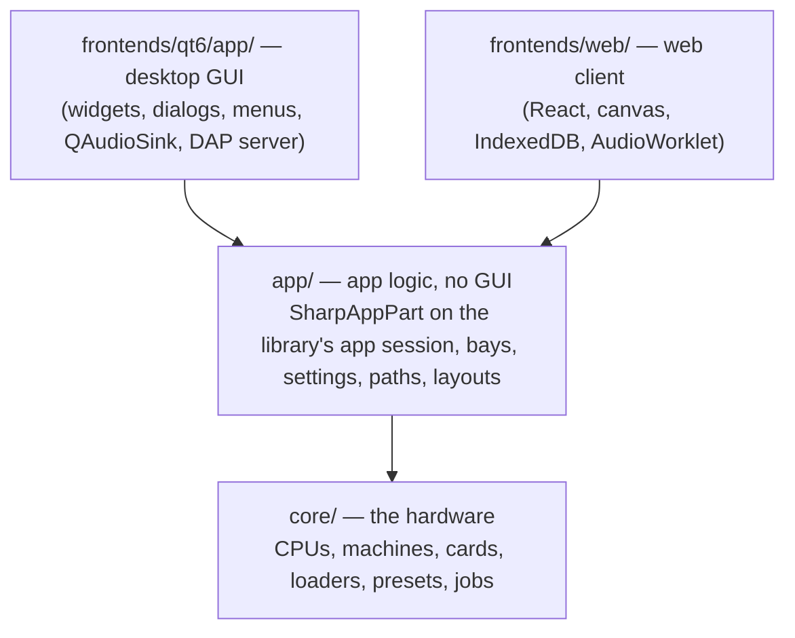

# Shared architecture: Core, Shared, frontends

Calc-U-1600 is built in three layers, so the desktop app and the
WebAssembly client ([Web-Client.md](Web-Client.md)) run the same emulator
and the same app logic:

- **`core/`** is the emulated hardware and what drives it: CPUs, machines,
  cards and connectors, program and preset loaders, the debugger core.
- **`app/`** is everything above Core that is not drawing: the product's
  part of the library's app session (the live machine and its operations,
  the module/floppy/tape bays), the pacing profiles, settings keys, file
  locations, and the layout numbers renderers draw with. The session
  itself -- operations, busy, pacing, sound policy, messages -- is the
  library's (`library/sessions/`, `library/pacing/`; LIB-3, LIB-17).
- **A frontend** keeps widgets and painting, dialogs, menus, settings
  storage, the audio device, the debugger transport and packaging.

Both libraries are built by [`cmake/CalcU.cmake`](../../cmake/CalcU.cmake)
(`calcu_core`, `calcu_shared`) for the Qt app, the CLIs, the tests and the
WebAssembly check.

## Rules

- **Non-GUI logic goes in `app/`.** A frontend translates types only
  (QString ↔ `std::string`, Qt keys → `shared::HostKey`, pixel buffers →
  QImage) and shows what Shared decides.
- **Portable C++20, standard library only.** No Qt, Cocoa or Emscripten
  headers in Core or Shared. Paths are UTF-8 `std::string`s converted
  through `app/Utf8Path.hpp` (Windows code pages).
- **Single-threaded and never blocking.** Everything runs on the
  frontend's one thread. Long machine work (a boot, a preset, a typed
  program, a power cycle) is a resumable job (below), never a blocking
  loop with a yield hook. There is no threaded mode (unlike Calc-U-59's
  Shared layer); see Decisions.md.
- **Shared never decides where files live.** The frontend hands it the
  host's folders (`calcu::settings::HostDirs`: home, the settings base of its
  platform, on the Web the save folder) and the bundled-resources folders
  (`shared::BundleDirs`), and opens the settings file, `Calc-U-1600.ini`
  (`calcu::settings::SettingsFile` at `settingsFilePath()`, LIB-9); the
  library's `calcu::settings::Paths`, `shared::AppPaths` and
  `shared::Settings` (the declaration of every key, `settingsDecl()`) do the
  rest. No frontend keeps a setting in QSettings or `localStorage` (CTest
  `CalcU1600NoPlatformSettings`).
- **Messages for the user** come back as English sentences (the app has no
  translations).

## The pieces

| File | What it is |
|---|---|
| `SharpAppPart` | Calc-U-1600's part of the library's app session (a `calcu::sessions::SessionPart`): the live PC-1500/1500A/1600 as one `calcu::machine::Machine` handed to the machine session, model and ROM switches, memory-module slots, peripherals, tape, host drive, trace, inspector; the bays; the Sharp operations as `c1600.*` commands; the interim topics `c1600.control-state`, `c1600.machine`, `c1600.tapes`, `c1600.serial-links` and LIB-12's `roms-missing` (`SharpTopics.hpp`; see "The machine" below) |
| `SharpMachineParts` | The adapters around the machine session: `SharpTypingHook` (host keys, `hostKeyDown`, the paste queue, timed taps; until M-36) and `SharpDebuggerGate` (the debugger's run control; until M-45) |
| `SharpSession` | `makeSharpSession()`: the library's app session with the part, which the session owns (Qt6, tests, `tools/wasm_smoke`); a host talks to it through the library's `calcu::sessions::Listener` |
| `SharpWebPart` | What the Web page draws, as product topics, commands and requests (`c1600.ui`, `c1600.lcd`, …; LIB-15 1600) |
| `ModuleBay`, `FloppyBay`, `TapeBay` | The control bar's slots, disk and tape: catalogues, attach, Name & Save, preset `saveas:`, debounced autosave |
| `PresetCatalog` | The bundled presets of `examples/bundled.yaml` (`defaults`, `examples`) and any preset's short name and description; `examples:` refs resolve through `AppPaths` |
| `PacingProfiles`, `AudioSink` | The Sharp pacing profiles (LIB-17 AC-20: the slice is the call, no jitter, full speed never paced); the host's audio output and `SoundFeed`, which plays the session's sound messages into it |
| `Settings`, `AppPaths`, `Utf8Path` | Every settings key with its default (the declaration of `Calc-U-1600.ini`); the save/tapes/bundle folders and by-name save paths |
| `HostKeyMap`, `KeyLayout/`, `LcdLayout`, `PlotterPaper`, `Rgb` | Host keys → calculator keys; key hit-regions and the faceplate fit; LCD geometry, colours and status indicators (`lcd::indicators()`); plotter-paper geometry |
| `MachineModel` | The `Model` and ROM-version enums |
| `ControlState` | What the pickers, menus and panels offer right now: every rule about which control a model has and which peripheral excludes which |
| `MediaLibrary` | The save folder's cards, disks and tapes as items to list, export, import and delete (the web's Saved Media…) |
| `MachineCodeLoad` | Load BASIC Program… / Load Machine Code…: a WAV's files to pick from, then the load and its advice |
| `CardYamlDump` | The INSPECTOR's Card YAML: each slot's module RAM as an `initial-content:` block |
| `DisplayFrame` | One model-agnostic LCD frame a renderer paints from, made from the machine's display output (`toDisplayFrame`, an adapter until M-49) |
| `DirectoryScanCache`, `Text` | A media folder's last parse, reused while its files are unchanged; small string helpers |

## The machine

`SharpAppPart` builds the live machine and hands it to the library's
machine session (`MachineSession::setMachine`, with its pacing profile),
which owns it (C1600-1; the library's machine interface, `library/machine/`). Nothing in `app/` or a frontend names
`PC1500Machine` or `PC1600Machine`: the CTest `CalcU1600MachineIncludeCheck`
(`tools/check_machine_includes.sh`, Frequent and CI) fails the build when a
file in `app/`, `frontends/`, `tools/` or `dev/` includes or names one.

- **Building.** `calcu::machine::build(catalogue, SharpMachineBuilder, request)`
  with a copy of `sharp::sharpCatalogue()` (the models, CE-150, CE-158,
  CE-1600P, host drive) to which the module definitions are added
  (`sharp::addModuleDefinitions`, `moduleDescriptor`; the CE-502B's from
  the ROM set). The ROM images come from the session's ROM set: one
  lookup when `SharpAppPart` is made (`sharp::lookUpRoms`,
  `core/Machine/SharpRoms`, LIB-12) over the bundled resources folder,
  then `RomSet::imagesFor()` for every build and attach; the preset
  loaders get it as `PresetRoms`. Without the full set no machine is
  built: the `start` command is refused with the lookup's message and the
  `roms-missing` topic carries it (LIB-12 AC-5). Every rebuild is then a `coldBoot()`.
- **Operations and keys.** `reset()`, `coldBoot()`, `powerCycle()` (the
  off / on sequence now runs inside the core, `core/Machine/PowerCycleSequence`),
  then `sharp::legacy::runToPromptJob` (until M-46). Keys are key IDs
  (`keyDown`/`keyUp`; `on` is one of them); the PC-1500's paced keystroke
  queue is the `c1600.key-queue` kind.
- **Peripherals** are `attach`/`detach`/`replace` in the places `slot-1`,
  `slot-2`, `printer`, `interface`, `host-drive`; a change on a running
  machine reaches the bus at the off point of the power cycle that follows.
  The CE-1600P with the CE-158, or a second printer, is refused with a
  sentence.
- **What only a Sharp machine has** is a capability: the product kinds
  `c1600.loader-memory`, `c1600.inspector`, `c1600.ce158-printer-port`,
  `c1600.host-drive-folder`, and the adapter kinds `c1600.plotter-paper`,
  `c1600.trace`, `c1600.tape-deck`, `c1600.floppy-drive`
  (`core/Machine/SharpProductKinds.hpp`); the library's `serial-port`,
  `real-time-clock` and `controls` (the CE-161's write-protect switch).
  What has no seam yet (loaders, preset loaders, the debug target, the
  PC-1600's typing latches, the card in a slot) goes through
  `core/Machine/LegacyCalls.hpp`, each call with the step that removes it.
- **Serial ports and clock.** LIB-2's session part
  (`calcu::peripherals::PeripheralsPart`, listed before `SharpAppPart`)
  holds the `HostLinks` (the pseudo-terminals, `calcu1600-rs232c.serial`,
  `calcu1600-ce158.serial`), pumps them before and after each host call and
  sets the real-time clocks from the host at a new machine and at the end
  of every operation (LIB-2 AC-23).
- The machines hold no lock and start no thread (ADR 0009); the host links'
  own reader and writer threads touch only their rings.

## How a frontend drives it

A frontend hosts the library's app session (LIB-3) and talks to it by
messages: it sends commands and requests, and keeps what the topics send.

1. Open the `SettingsFile`, build `Settings` over it and `AppPaths` (with
   its `HostDirs` and `BundleDirs`), then the session with
   `makeSharpSession()` (or, like the Web engine, the part and the session
   by hand: the part's `sessionParts()` in the `AppSessionSetup`, the part
   in its `owned`), and listen with a `calcu::sessions::Listener`, stating
   the frontend's host services (an audio sink; a folder picker offers
   File ▸ Mount Directory).
2. Send `start`: the startup model (or the one named), cold booted, then
   its default preset or the preset named -- an operation.
3. Call `session().call(now)` from a ~60 Hz timer. The library's pacer
   runs the machine at the speed last commanded (`speed {full}` while the
   display is held), or one part of the running operation; the parts do
   their per-call duties (autosave, tape); the topics that changed go out.
   Repaint from the `display` topic (`displayFrameOf`, `lcd::indicators()`).
4. Resolve host keys with `resolveHostKey()` and hand them to
   `part().typing().hostKeyDown()` (adapter until M-36); release what it
   asks to with `hostKeyUp()`. Keys pressed while an operation runs are
   dropped (behaviour change 1600-9).
5. Start operations with their commands (`c1600.load-preset`,
   `c1600.reset`, `c1600.pick-model`, `c1600.toggle-peripheral`, …;
   `SharpTopics.hpp`). The reply comes when the operation ends; the `busy`
   topic says it runs and whether at full speed ("Loading…"). A failure is
   also a notice. Reset, Cold boot and a model switch stop a running one.

The Qt app does this: `MachineController` hosts the session on the GUI
thread, listens through a `Listener` and turns its messages into signals,
`EmulationPacer` makes the host call from a QTimer, `Operations` sends the
commands and shows "Loading…" from the busy topic, `AudioOutput` is the
QAudioSink behind a `SoundFeed`, and `MainWindow` keeps only the
physical-key map and the Shift-tap timer. The Web engine does it in the
library's worker ([Web-Client.md](Web-Client.md)). The harness `calcu`
runs the library's app session on the product's machine (LIB-11).

## Jobs: resumable machine work

[`core/Job.hpp`](../../core/Job.hpp) turns the blocking sequences into
C++20 coroutines; since M-31 it names the library's (`calcu::sessions::Task`,
`Job`, `request`; adapter JobForward), so a job runs inside an operation of
the app session. Wherever the code ran the machine — `machine.runCycles(n)`
— it now says `co_await job::run(machine, n)`. A `job::Job` runs the
coroutine a budget at a time (`step(cycles)`), or straight through
(`job::runToCompletion()`, which every old blocking function name now
calls, so the CLIs and tests didn't change).

A run request is never split by the budget, so a job sliced into frame
ticks makes exactly the machine calls of one run straight through:
`tests/job_tests.cpp` checks five presets for identical step logs,
results, memory, PCs and LCD both ways.

Writing one: every function that (transitively) runs the machine returns
`job::Task<T>` and awaits the ones it calls; take parameters by value
(except the machine and out-pointers) — a Task starts lazily, after the
expression that created it.

## WebAssembly

`tools/build_wasm_check.sh` builds Core + Shared with Emscripten and runs
`tools/wasm_smoke.cpp` under node: the library's app session in virtual
time, three presets through their commands, typed input. `libsharpdx-wasm.a` is the
program loaders' Rust library built for `wasm32-unknown-emscripten`
(`tools/build_sharpdx_wasm.sh`). Native wasm exceptions
(`-fwasm-exceptions`), no threads; there are no host links there (the
library's `NoHostLink.cpp`). The web client builds the same libraries as the `calcu_web`
target ([Web-Client.md](Web-Client.md)).

## Not in Shared yet

- The DAP debugger (`frontends/qt6/app/debug/`): its protocol logic is written
  against QJson and needs a JSON value type in Shared first.
- The CLIs build their own preset environment rather than using the app
  session (until LIB-11 replaces them, M-51).

These are rows in [TODO.md](../../TODO.md).
