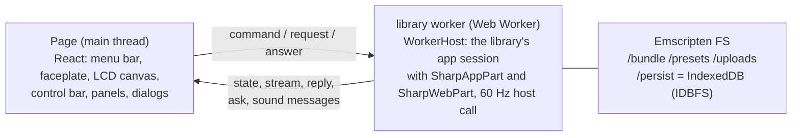

# Web client

The browser frontend: the same `core/` + `app/` as the desktop app,
compiled to WebAssembly, with a React page that looks like the Qt window.
One build (`frontends/web/dist/`) serves two uses:

- **embedded** in a web page, as a component;
- **installed** as an offline app (`dist/app/`, a PWA), for a tablet.

It is made for landscape screens and tablets; a phone works (touch takes
the nearest key, the menus are taller on touch screens) but gets the
calculator alone in landscape. The calculator comes first: the faceplate is as large as the client
allows, and the panels (inspector, paper, printer) appear only when
the faceplate spans the full width and leaves at least 220 px below it --
in portrait and in tall windows, not on a phone in landscape or in a wide,
short window. The paper panel is the library's (`CalcuPaperPanel`)
and is always there, named after the plotter plugged in.
Narrower than 700 px, the inspector gives way to the printer, or to the
paper while a plotter is plugged in.



The messages are the session protocol's
([`docs/formats/session-protocol.md`](../../../../docs/formats/session-protocol.md)
at the repository root).

## Layout of `frontends/web/`

| File | What it is |
|---|---|
| `bindings.cpp` | The product's factory of the library's app session (`CALCU_WEB_PRODUCT(CalcU1600Host, …)`): the library's `SettingsPart` and `ControlPart` (no host folder in a browser and the uploads folder for Upload Preset…'s files, `SharpAppPartOptions`), `SharpAppPart`, `SharpWebPart` (app layer) and the session; the library's `WorkerHost` translates its messages |
| `src/CalcU1600.jsx` | The page, put together from the React set's shell: `useCalcuShell` over the library's `useShell()`, `ShellMenuBar`, `ShellControlBar` (the slot picker `ShellSlotPicker` with Name & Save, the disk controls in its `extra`), the shell's dialogs (Saved Media… `ShellSavedMedia`), notices, "Loading…" and "ROMs missing"; the product's data from the request `c1600.shell-product` through the library's `useShellProduct` (`app/SharpShellProduct`: items, labels, the settings spec), the faceplate's hit map and LCD layout from `c1600.faceplate-map {model}` through `useFaceplateMaps`; Load Preset… and the drop through `calcuOpenFiles` and `calcuFileDrop` (a drop of exactly one file); the page's glue is the library's (`library/web/components/useShellProduct.jsx`, `ShellMedia.jsx`; `calcImage`, `sizeCanvas` in `library/web/src/canvas.js`). The loaders: `c1600.file-kind`, `c1600.load-basic`, `c1600.code-plan` (asked again per keystroke in the address dialog), `c1600.load-code`, each carrying the file's bytes (`app/SharpLoaderPart`) |
| `src/*.jsx`, `src/*.js` | The client, compiled with the library's page side (`library/web/src/`) into one `dist/calc.js` (one global, `CalcU1600`) |
| `calc.css` | Styles, all under `.calcu-client`, light and dark |
| `app/` | The installable app's page, manifest and stylesheet; its app page, service worker and worker entry are the library's (`library/web/app/`) |
| `build.sh`, `build.js` | The build (below): `build.js` names what is the product's (the engine, the worker's configuration with the mount `/persist` and the lock `calcu1600-storage`, the files, the sources), the library's `library/web/build/product.js` does the steps |
| `tests/`, `run-tests.sh`, `playwright.config.js` | Playwright tests; the servers and the shared configuration are the library's (`library/web/tools/playwright.sh`, `playwright-config.js`) |

## Build and test

```sh
frontends/web/build.sh        # emcmake build of the calcu1600_web target, then dist/
frontends/web/run-tests.sh    # Playwright on ports 8160 and 8161: root, sub-path, offline (Chromium, WebKit), prerender
```

`build.sh` needs `emcmake` (emsdk 6.0.13, as for the
[WebAssembly check](../../../../docs/Building.md#the-web-clients)), node and the ROMs. The
engine is the CMake target `calcu1600_web` of the repository's root project,
built in its `build/web` tree
(`calcu1600-core.js` / `.wasm`): no `-pthread`, native wasm exceptions,
`IDBFS`. `build.js` hands the product's values (engine, worker
configuration, the files of `dist/`, sources, component) to the library's
Web build (`library/web/build/product.js`, the same steps for Calc-U-59;
`CALCU_WEB_DIST` names another output folder, `CALCU1600_ROMS_DIR` another
ROM folder), which builds the engine, copies the files, writes
`calc-engine-worker.js` and runs the library's product build
(`library/web/build/dist.js` `buildProduct`, which the library's test
product uses too): it compiles the JSX with the library's vendored Babel (`library/web/vendor/`, also React 18, ReactDOM and ReactDOMServer; no npm
runtime dependencies), fails on a `calc.css` selector outside `.calcu-client`, copies
[`examples/bundle.yaml`](../../examples/bundle.yaml) and exactly the files it
lists (each preset and the files it names; nothing else of `examples/`) into
`presets/` (the page's Examples come from the session's `preset-list`
request), writes `files.json`, stamps
the service worker's precache list and writes `MANIFEST.json`; the version
is the one `release.yaml` names (the Qt app's `APP_VERSION`, as ReleaseIt
and the help tool read it). `run-tests.sh` serves `dist/` with the
library's `library/web/tools/serve.py` (started by `library/web/tools/playwright.sh`); the offline and prerender tests use
`library/web/tests/dist-helpers.js`. `build.sh` makes the test build (the
CMake option `CALCU_WEB_TEST_AIDS` ON in `build/web`: the session answers
the Web tests' `c1600.upload` and `c1600.display-text`); `build.sh
--release` the release build, without them (the option OFF; only
`app/SharpWebPart.cpp` is compiled again). CI's `web` job
builds the test build and tests it, then builds `--release`, checks it
(`tests/web_no_test_aids.sh frontends/web/dist`) and uploads that one as
`Calc-U-1600-web-<version>.zip`; a release attaches it as
`Calc-U-1600-web.zip`.

## The `dist/` contract

- **Location independent.** Every URL is relative to `calc.js`
  (`document.currentScript`), so `dist/` works under any path. The tests
  serve it at a root and under `/anything/calc/`.
- **Embedding.** A page loads React 18, then `calc.css` and `calc.js`
  (classic scripts), and renders
  `React.createElement(CalcU1600, props)`:

  The props are the family's shared ones (`docs/formats/web-embed.md`
  §1.1 at the repository root); Calc-U-1600 has no prop of its own.
  `layout` takes only `"auto"`, the default; `model` takes `PC-1500`,
  `PC-1500A` or `PC-1600`; without `width` and `height` the client fills
  its parent.

- **Prerender-safe.** Rendering has no side effects: the worker, fetches
  and listeners start in effects (`tests/prerender.spec.js`).
- **Scoped.** Styles are scoped to `.calcu-client`; `calc.js` adds only
  the `CalcU1600` global.
- **Test hooks.** `.calcu-client[data-ready=true]` once the session's
  start is over; the root element's `calcuShell` is the library's shell
  (`createShell`: `send`, `request` by the session's names, e.g. the
  request `c1600.display-text` (test build only), `ticks`); `.calcu-face[data-model=<model ID>]`
  (`PC-1600`), the shell's `data-calcu` names (`menu-file`,
  `item-<id>`, `control-bar`, `bar-model`, `bar-place-<place>`,
  `settings-dialog`, `notice`, `loading`, `roms-missing`; library
  `shell/ObjectNames.hpp`), helpers in `tests/helpers.js`,
  `.calcu-key[aria-label=<key>]`, `[data-panel=inspector|paper|printer]`
  (`data-empty`; the paper panel's own names are `[data-calcu=paper-owner]`,
  `paper-copy`, `paper-cut`, … of `library/web/components/PaperPanel.jsx`),
  `[data-dialog=...]`. `pause` and `resume` are the library's run control;
  the title follows the `run-state` topic.
- **Same origin.** The worker and the service worker must come from the
  page's origin.

## Storage

- Settings: `Calc-U-1600.ini` at `/persist/settings/Calc-U-1600/`, in the
  same IDBFS mount as the save folder (the keys of `app/Settings.hpp`, the
  same as Qt6's; the ones the Web has no use for are kept and ignored).
  Nothing is kept in `localStorage`.
- The save folder (`AppPaths` home `/persist`): saved cards, disks, tapes.
  It is an IDBFS mount with `autoPersist`, so every write, rename and
  delete reaches IndexedDB without help. The embedded client and the app
  on one origin share it.
- **One writing tab.** The worker takes the Web Lock `calcu1600-storage`.
  A tab that doesn't get it reads the storage once, keeps its changes in
  memory and shows a banner and the library's notice (`web.storage`).
- Hidden, the page sends the session `suspend` and the worker stops
  calling it; shown again, `continue`.
- File ▸ Import Media… / Saved Media… reach the save folder through the
  library's media part (`media.import`, `media.export`, `media.delete`; the
  dialog is the library's `CalcuSavedMediaDialog` in `ShellSavedMedia`).

## What the web client leaves out

Things that are only in the Qt app, or that a browser can't do:

- the DAP debugger (`app/dap/` is not in the Emscripten build);
- serial ports (PC-1600 RS-232C, CE-158 serial: host PTYs);
- the host drive S3: (Host Drive…);
- the INSPECTOR's TRACE and LOG;
- Quit, window size, folder settings.

## Input

- **Pointer.** One key per pointer, so a tablet can hold SHIFT and a
  key with two fingers. Holding the LCD runs at full speed.
- **Keyboard.** `KeyboardEvent.code` / `.key` go to
  the library's `host-key-down` / `host-key-up` (the library's
  `components/hostKeys.js` turns the event into the command's fields and
  keeps the keys held; the product's keyboard map in the
  engine decides). A bare Shift tapped within 400 ms is one screen press
  of SHIFT.
  Auto-repeat is ignored and held keys are released on blur. The web keeps
  no hold of its own: the typing engine holds every key at least 4
  emulated frames and a following press waits for it, so a press and
  release in one frame are still scanned. Faceplate keys are
  `screen-key-down` / `screen-key-up`.
- **Clipboard.** ⌘/Ctrl+C copies the screen; ⌘/Ctrl+V pastes text (the
  browser's paste event).
- **Drag and drop.** One file, sent as the session's `open` (way `drop`, an
  upload): the session refuses a file over 1 MiB, decides what
  it is, imports a medium first and keeps a file that comes while busy; a
  program file comes back as the topic `c1600.program-opened` and runs the
  flow of Load BASIC Program… or Load Machine Code…. Upload Preset… sends
  its files the same way (way `dialog`; several are one folder in
  `/uploads`, the preset among them opened).
- **Audio.** The AudioContext starts on the first key or click (a browser
  rule); the session sends the sound at regular speed only,
  and the library's `audio.js` plays it through its AudioWorklet.
- **Keys during an operation** (a preset, a reset, a model switch) are
  dropped, not pressed after it.
