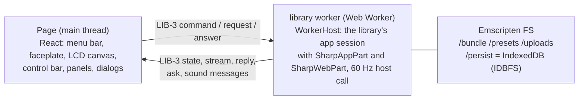

# Web client

The browser frontend: the same `core/` + `app/` as the desktop app,
compiled to WebAssembly, with a React page that looks like the Qt window.
One build (`frontends/web/dist/`) serves two uses:

- **embedded** in a web page, as a component;
- **installed** as an offline app (`dist/app/`, a PWA), for a tablet.

It is made for landscape screens and tablets; a phone works (touch takes
the nearest key, the menus are taller on touch screens) but gets the
calculator alone in landscape. The calculator comes first: the faceplate is as large as the client
allows, and the panels (inspector, paper, printer) appear only when
the faceplate spans the full width and leaves at least 220 px below it --
in portrait and in tall windows, not on a phone in landscape or in a wide,
short window. The paper panel is the library's (`CalcuPaperPanel`, LIB-8)
and is always there, named after the plotter plugged in (LIB-8 AC-36).
Narrower than 700 px, the inspector gives way to the printer, or to the
paper while a plotter is plugged in.



## Layout of `frontends/web/`

| File | What it is |
|---|---|
| `bindings.cpp` | The product's factory of the library's app session (`CALCU_WEB_PRODUCT(CalcU1600Host, …)`): `SharpAppPart`, `SharpWebPart` (app layer) and the session; the library's `WorkerHost` translates its messages |
| `calc-engine-worker.js` | The product's entry to the library's worker (`library/web/src/worker.js`, `dist/library-worker.js`): name, wasm, mount `/persist`, lock `calcu1600-storage` |
| `src/engine.js` | Translates the components' calls to the session's commands and requests, and its topics to their slices, over the library's `createShell()` (until LIB-14 1600, M-49). The loaders (C1600-2): `fileKind`, `loadBasic`, `planCode` (asked again per keystroke in the address dialog), `loadCode`, each carrying the file's bytes (`app/SharpLoaderPart`) |
| `src/*.jsx`, `src/*.js` | The client, compiled with the library's page side (`library/web/src/`) into one `dist/calc.js` (one global, `CalcU1600`) |
| `calc.css` | Styles, all under `.calcu-client`, light and dark |
| `app/` | The installable app's page, manifest and stylesheet; its app page, service worker and worker entry are the library's (`library/web/app/`) |
| `build.sh`, `build.js` | The build (below) |
| `tests/`, `run-tests.sh` | Playwright tests |
| `vendor/` | React 18, ReactDOM, ReactDOMServer (tests), Babel (build only) |

## Build and test

```sh
frontends/web/build.sh        # emcmake build of the calcu_web target, then dist/
frontends/web/run-tests.sh    # Playwright: root, sub-path, offline (Chromium, WebKit), prerender
```

`build.sh` needs `emcmake` (emsdk 6.0.13, as for the
[WebAssembly check](Building.md#webassembly-check)), node and the ROMs. The
engine is the CMake target `calcu_web` of the repository's root project,
built in its `build/web` tree
(`calcu1600-core.js` / `.wasm`): no `-pthread`, native wasm exceptions,
`IDBFS`. `build.js` uses the library's build steps (`library/web/build/dist.js`):
it compiles the JSX with the vendored Babel (no npm
runtime dependencies), fails on a `calc.css` selector outside `.calcu-client`, copies
[`examples/bundle.yaml`](../../examples/bundle.yaml) and exactly the files it
lists (each preset and the files it names; nothing else of `examples/`) into
`presets/` (the page's Examples come from the session's `preset-list`
request), writes `files.json`, stamps
the service worker's precache list and writes `MANIFEST.json`. CI's `web`
job builds, tests and uploads `Calc-U-1600-web-<version>.zip`; a release
attaches it as `Calc-U-1600-web.zip`.

## The `dist/` contract

- **Location independent.** Every URL is relative to `calc.js`
  (`document.currentScript`), so `dist/` works under any path. The tests
  serve it at a root and under `/anything/calc/`.
- **Embedding.** A page loads React 18, then `calc.css` and `calc.js`
  (classic scripts), and renders
  `React.createElement(CalcU1600, props)`:

  | Prop | Meaning |
  |---|---|
  | `width`, `height` | The client's size in CSS pixels (default: its parent's size) |
  | `keyboard` | Take the physical keyboard while focused (default true) |
  | `model` | A model's name (`PC-1500`, `PC-1500A`, `PC-1600`; 0-2 still taken): start with it (read once, at mount) |
  | `preset` | A bundled preset to load at start, by its path in `bundle.yaml` (`plotter/lissajou-1600.pc1600`; started as `examples:<path>`) |
  | `workerUrl` | Another worker entry (the app uses `app/engine-worker.js`) |

- **Prerender-safe.** Rendering has no side effects: the worker, fetches
  and listeners start in effects (`tests/prerender.spec.js`).
- **Scoped.** Styles are scoped to `.calcu-client`; `calc.js` adds only
  the `CalcU1600` global.
- **Test hooks.** `.calcu-client[data-ready=true]` once the session's
  start is over; its `calcuEngine.request(method, ...args)` sends the
  command or request `src/engine.js` maps the method to (`lcdText` reads
  the screen, `ticks` the emulated time); `.calcu-face[data-model]`,
  `.calcu-key[aria-label=<key>]`, `[data-panel=inspector|paper|printer]`
  (`data-empty`; the paper panel's own names are `[data-calcu=paper-owner]`,
  `paper-copy`, `paper-cut`, … of `library/web/components/PaperPanel.jsx`),
  `[data-dialog=...]`. The engine's `pause` and `resume` are the library's
  run control (LIB-10); `getState().paused` follows the `run-state` topic.
- **Same origin.** The worker and the service worker must come from the
  page's origin.

## Storage

- Settings: `Calc-U-1600.ini` at `/persist/settings/Calc-U-1600/`, in the
  same IDBFS mount as the save folder (the keys of `app/Settings.hpp`, the
  same as Qt6's; the ones the Web has no use for are kept and ignored).
  Nothing is kept in `localStorage`.
- The save folder (`AppPaths` home `/persist`): saved cards, disks, tapes.
  It is an IDBFS mount with `autoPersist`, so every write, rename and
  delete reaches IndexedDB without help. The embedded client and the app
  on one origin share it.
- **One writing tab.** The worker takes the Web Lock `calcu1600-storage`.
  A tab that doesn't get it reads the storage once, keeps its changes in
  memory and shows a banner and the library's notice (`web.storage`).
- Hidden, the page sends the session `suspend` and the worker stops
  calling it; shown again, `continue` (LIB-3 AC-36).
- File ▸ Import Media… / Saved Media… reach the save folder through the
  library's media part (`media.import`, `media.export`, `media.delete`; the
  dialog is the library's `CalcuSavedMediaDialog`, LIB-7 AC-43).

## What the web client leaves out

Things that are only in the Qt app, or that a browser can't do:

- the DAP debugger (not in Shared);
- serial ports (PC-1600 RS-232C, CE-158 serial: host PTYs);
- the host drive S3: (Mount Directory);
- the INSPECTOR's TRACE and LOG;
- Quit, window size, folder settings.

## Input

- **Pointer.** One key per pointer, so a tablet can hold SHIFT and a
  key with two fingers. Holding the LCD runs turbo.
- **Keyboard.** `KeyboardEvent.code` / `.key` go to
  the library's `host-key-down` / `host-key-up` (src/engine.js turns the
  event into the command's fields; the product's keyboard map in the
  engine decides). A bare Shift tapped within 400 ms is one screen press
  of SHIFT.
  Auto-repeat is ignored and held keys are released on blur. The web keeps
  no hold of its own: the typing engine holds every key at least 4
  emulated frames and a following press waits for it, so a press and
  release in one frame are still scanned. Faceplate keys are
  `screen-key-down` / `screen-key-up`.
- **Clipboard.** ⌘/Ctrl+C copies the screen; ⌘/Ctrl+V pastes text (the
  browser's paste event).
- **Drag and drop.** One file, sent as the session's `open` (LIB-13, way
  `drop`, an upload): the session refuses a file over 1 MiB, decides what
  it is, imports a medium first and keeps a file that comes while busy; a
  program file comes back as the topic `c1600.program-opened` and runs the
  flow of Load BASIC Program… or Load Machine Code…. Upload Preset… sends
  its files the same way (way `dialog`; several are one folder in
  `/uploads`, AC-8).
- **Audio.** The AudioContext starts on the first key or click (a browser
  rule); the session sends the sound at regular speed only (LIB-3 AC-37),
  and the library's `audio.js` plays it through its AudioWorklet.
- **Keys during an operation** (a preset, a reset, a model switch) are
  dropped (behaviour change 1600-9).
