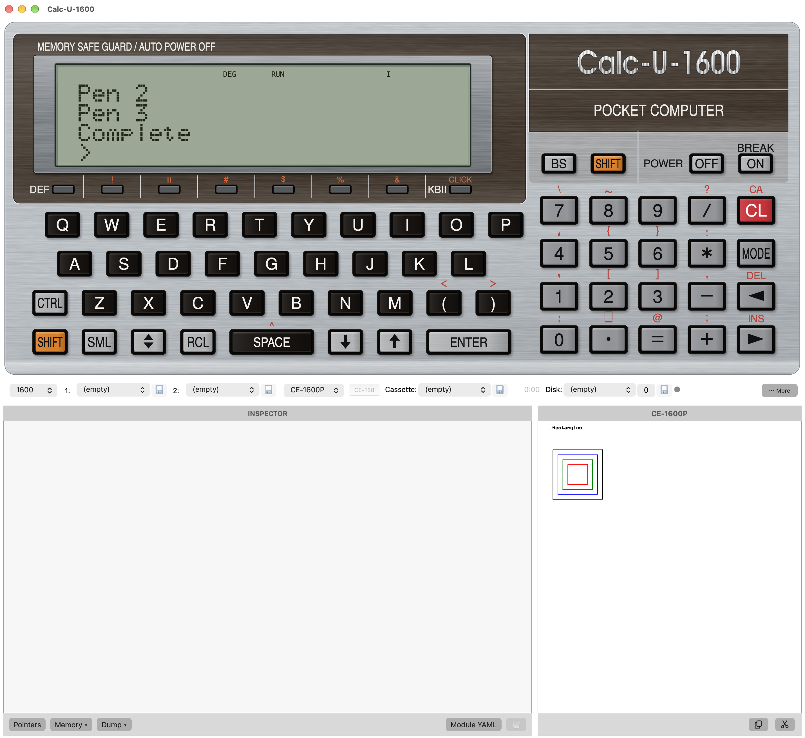
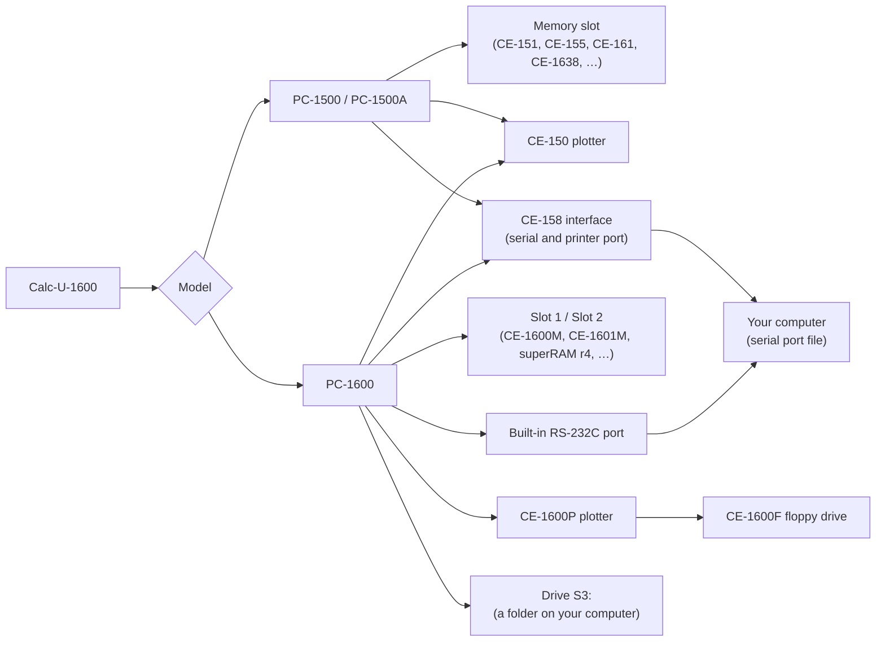

# Introduction

Calc-U-1600 emulates three Sharp pocket computers: the **PC-1500**, the
**PC-1500A** and the **PC-1600**. Around them it emulates the memory
modules, the CE-150 and CE-1600P plotters with their cassette interfaces,
the CE-1600F floppy drive and the CE-158 interface. It connects the
computers' serial ports to your computer, and on the PC-1600 a folder on
your computer can be a drive.

Calc-U-1600 runs as a desktop program on macOS, Linux and Windows, and in
the browser ([The browser version](02-getting-started.md#the-browser-version)).
This help describes both; where the browser differs, it says so.

The window has three parts:

- **The faceplate** (the keys and the LCD) at the top.
- **The control bar** below it: the model, the memory slots and the
  peripherals.
- **The panels** at the bottom: the INSPECTOR and the plotter's paper,
  plus the CE-158's printer output while a CE-158 is plugged in.

Everything you can plug into the real computers, Calc-U-1600 can plug in
too:

## Where to go next

- [Getting started](02-getting-started.md): the faceplate, the keyboard,
  Copy Screen and Paste Text on these models; the window, the control bar
  and the menus are in the family's
  [Getting started](../../../library/help/02-getting-started.md).
- [Memory modules and floppy disks](04-media.md),
  [plotters and the CE-158](05-peripherals.md), [presets](06-presets.md).
- [Product topics](09-product-topics.md): loading BASIC and machine-code
  programs, the COM ports, a folder as a drive, and more.
