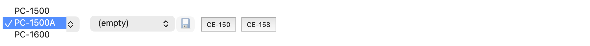
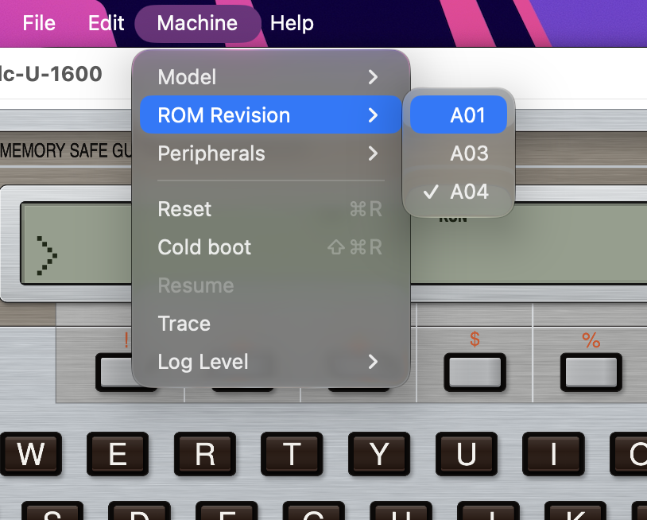
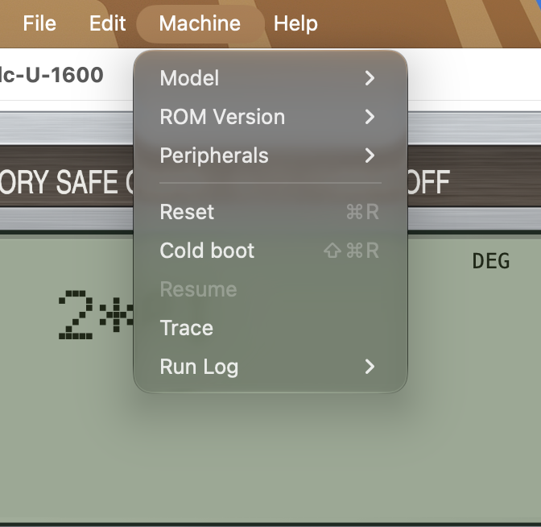
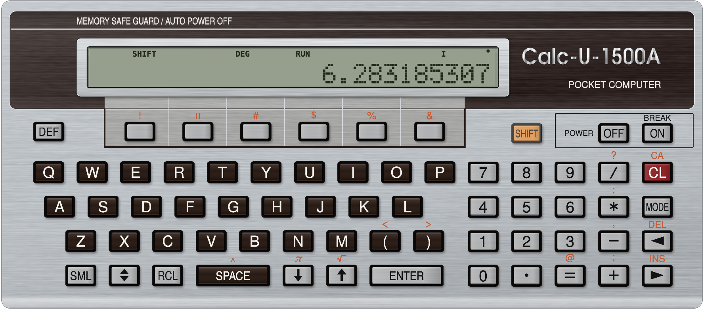
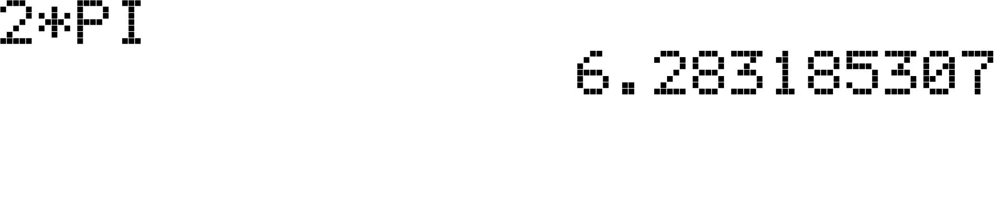

# Getting started with Calc-U-1600

The window, the control bar, the menus and the settings dialog are the
family's; the [shared part of this chapter](../../../library/help/02-getting-started.md)
describes them ([the window](../../../library/help/02-getting-started.md#the-window),
[the menus](../../../library/help/02-getting-started.md#the-menus),
[desktop and mobile](../../../library/help/02-getting-started.md#desktop-and-mobile),
[the control bar](../../../library/help/02-getting-started.md#the-control-bar)). This part shows what they hold on the PC-1500, the
PC-1500A and the PC-1600, and how the keyboard and the faceplate work on
these models.

Calc-U-1600 starts straight into BASIC on the model you used last (the
PC-1500A the first time), with its startup preset if you set one
([Presets](06-presets.md#startup-presets)). There is no separate power-on
step.

## The control bar and the Machine menu

The control bar starts with the model, by its short name (1500, 1500A,
1600; the menus name it in full). Then come the memory slots (one on the
PC-1500 and PC-1500A, two on the PC-1600), and the peripherals:

- **PC-1500 and PC-1500A:** the buttons **CE-150** and **CE-158**.
- **PC-1600:** a printer picker (No printer, CE-150, CE-1600P) and the
  button **CE-158**.

While a plotter with a cassette recorder is plugged in, the bar has the
cassette controls ([BASIC programs](09-basic-programs.md)); while the
CE-1600P is plugged in, the disk controls follow them
([Media](04-media.md#the-floppy-disk-pc-1600)). The **More** button (⋯)
is at the right edge.

On mobile (the browser version installed on a phone or tablet, a browser that
asks for the mobile site) the bar keeps the model, the memory slots and
the disk controls. The peripherals are in **More ▸ Peripherals ▸**, and
the cassette in **More ▸ Cassette ▸**: its cassettes to choose, then
**Name & Save…**.

The **Machine** menu holds the ROM choices of the running model and of the
plugged-in peripherals:

- **PC-1500:** **ROM Revision** A01, A03 or A04 (the default). The
  PC-1500A always runs its one ROM.

  

- **PC-1600:** **ROM Version** New (the default) or Old: the BASIC ROM.
- **CE-1600P ROM**, while the CE-1600P is plugged in: New (the default) or
  Old ([The plotters](05-peripherals.md#the-plotters)).

Reset, Cold boot and the model switch are the family's
([Models and machine control](../../../library/help/03-models-and-machine-control.md#reset-and-cold-boot));
what each keeps on these models is in [What differs by model](09-models.md).

## The keyboard

Your computer's keyboard drives the faceplate directly:

- **Letters, digits, `+ - * / ( ) . =`**, **Space**, **Enter/Return**
  (ENTER) and the **arrow keys** type as you'd expect.
- **Backspace** is BS on the PC-1600 and ← on the PC-1500 and PC-1500A.
- **F1–F6** are the six function keys.
- **Tab** is MODE (RUN/PRO).
- **Delete** is CL; **Shift+Delete** is SHIFT CL.
- A punctuation character that the faceplate has as a second legend
  (`!`, `#`, `@`, …) types directly; you don't press SHIFT first.
- **Shift tapped on its own** taps the faceplate's SHIFT, for the next
  key.
- A key held down stays down until you let it go, so the ROM's own
  auto-repeat works.
- Anything held with **⌘/Ctrl** (on Windows and Linux: Ctrl, Alt, the
  Windows key) is a shortcut and never reaches the faceplate.

The complete table, with the keys that exist only on an external PC-style
keyboard, is the [keyboard map](10-keyboard-map.md).

**Accented characters (PC-1600).** The PC-1600 types its international
characters with the latching **KB II** key: KB II, the letter, KB II
again. Pressing `ü` on your keyboard, pasting it, or using it in a
preset's `type:` step does that for you and keeps the case you typed. If
you have latched KB II yourself, accented keys of your keyboard do
nothing; type the plain letter instead.

## The faceplate

You can also click or touch the faceplate. A key stays pressed while you
hold it and lights up; a click in the gap next to a key, within 24
pixels, presses that key. Below, SHIFT is held and the LCD shows the SHIFT
symbol:

## Copy Screen and Paste Text

Calc-U-1600 has the **Edit** menu, after File: **Copy Screen** and
**Paste Text**.

**Edit ▸ Copy Screen** puts the LCD's dots on the clipboard as a picture
at the real display's size. Here is a PC-1600 LCD, as it gets pasted:

It also puts the screen on the clipboard as **text**, so a text editor
pastes the characters and a picture editor the dots. The text is readable
Unicode: the PC-1600's international and box-drawing characters and the
PC-1500's π, √ and ¥ appear as themselves. Graphics (`LINE`, `GPRINT`,
characters you defined) become blanks, and a screen with no text gives no
text. A graphic cell whose dots match a character, a block like `█` for
one, is copied as that character.

On the desktop, while text is selected in the INSPECTOR, the same item reads **Copy Log
Selection** and copies that text instead.

**Edit ▸ Paste Text** types the clipboard's **first line** into the
computer, key by key. It stops at the line break and doesn't press ENTER,
so you can check the line before you run it. Paste Text after Copy Screen
types the screen's first line back in. Each character is typed as the
keys the keyboard map gives for it; a character for which the computer
has no key is left out, and a key you press while the text is being
typed stops it. For whole programs, see
[Loading a BASIC program](09-basic-programs.md).

Presets type text too, with `type:` and `key:` steps
([Presets](06-presets.md)).

## The browser version

The same emulator runs in the browser at
[tinue.github.io/1600](https://tinue.github.io/1600), compiled to
WebAssembly, with the desktop program's faceplate, menus, control bar and
panels. It is made for tablets and desktop browsers; a phone works:
installed on the phone or asking for the mobile site, it shows in portrait
the panels alone, without the faceplate (its keys would be too small),
and in landscape the faceplate alone. The browser can install it as an
app, which then runs offline.

A link can choose the model by its name (`model=PC-1500`, `PC-1500A` or
`PC-1600`) and a bundled preset to start with:
`https://tinue.github.io/1600/calc/?model=PC-1600&preset=plotter/lissajou-1600.pc1600`.

| | Desktop | Browser |
|---|---|---|
| Models, modules, plotters, the CE-1600F | yes | yes |
| Presets: the examples, your own | **File ▸ Examples**, **File ▸ Load Preset…** | **File ▸ Examples ▸**, **File ▸ Load Preset…** |
| Saved modules, disks and cassettes | files in the save folder | kept in the browser; **Import Media…** brings files in, **Saved Media…** downloads or deletes them; only one tab saves, a second tab says so |
| Shortcuts for menu items | yes ([Shortcuts](../../../library/help/02-getting-started.md#shortcuts)) | none: they are the browser's; pasting still types |
| The debugger (VS Code) | yes | no |
| The serial ports (CE-158, the PC-1600's RS-232C) | yes | no |
| The host drive `S3:` (**File ▸ Host Drive…**) | yes | no |
| The INSPECTOR's TRACE and LOG | yes | no |
| Quit, the window size, the folder settings | yes | no |

## Opening files

A file you drop on the window, or open with **File ▸ Load Preset…**, is
opened as what it is; the family's rules are in
[Media](../../../library/help/04-media.md), and the kinds of file
Calc-U-1600 opens are in [this product's media part](04-media.md#opening-a-file).
