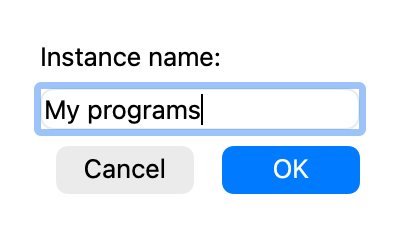

# Memory modules and floppy disks

Templates, instances, Name & Save, inserting and ejecting, the save folder
and files that cannot be read are the family's; the
[shared part of this chapter](../../../library/help/04-media.md)
describes them. This part covers the media of Calc-U-1600: the memory
modules, the CE-1600F's floppy disks, and which files the product opens.
Cassettes are in [Loading a BASIC program](09-basic-programs.md); a
folder of your computer as a drive is in [The host drive](09-host-drive.md).

## The slot pickers

Each memory slot has a picker in the control bar. The PC-1500 and
PC-1500A have one slot; the PC-1600 has two. A picker lists, from the top:

- **(empty)**
- The **battery-backed modules**: the bundled templates that fit this
  slot, your own templates, then your saved instances (here: "My
  programs").
- The **modules that are no media**: the CE-151, the CE-155 and the ROM
  modules, each where it fits the slot.

Choosing an entry plugs the module in at once, and the computer goes
through a power cycle, as when a module is plugged into the real one. The
memory is kept; the ROM then finds the changed memory and asks you to set
BASIC up again (`NEW0? :CHECK`), as on the real computer. A module change
leaves the other slot and the disk alone.

| Module | Models | What it is | Battery-backed |
|---|---|---|---|
| CE-151 | PC-1500/1500A, PC-1600 Slot 1 | 4 KB RAM | no |
| CE-155 | PC-1500/1500A, PC-1600 Slot 1 | 8 KB RAM | no |
| CE-161 | PC-1500/1500A, PC-1600 Slot 1 or 2 | 16 KB RAM with a write-protect switch | yes |
| CE-1638 | PC-1500/1500A, PC-1600 | 128 KB banked RAM (hobbyist module) | yes |
| CE-163F | PC-1500/1500A, PC-1600 | 128 KB RAM and 128 KB flash (hobbyist module) | yes |
| CE-502B | PC-1500/1500A | "Statistics" program module (ROM) | – |
| CE-1600M | PC-1600 Slot 1 or 2 | 32 KB RAM | yes |
| CE-1601M | PC-1600 Slot 2 | 64 KB banked RAM | yes |
| 256K custom | PC-1600 Slot 2 | 256 KB banked RAM of no particular make, initialised: 32 KB expansion memory and the RAM disk S2: (220,160 bytes free) | yes |
| superRAM r4 | PC-1600 Slot 2 | 1 MB banked RAM by spellbound, blank: it is initialised with SRAMINIT.BIN, which comes with the module, not with Calc-U-1600 (its insert notice says so when you plug it in) | yes |

A module without a battery (the CE-151, the CE-155) loses its contents at
a Cold boot; a battery-backed one keeps them
([What differs by model](09-models.md)). Modules of your own design are
[module definitions](09-module-definitions.md).

## Program modules on the PC-1500

A **program module** holds a BASIC program and its reserve keys in memory
the computer can't write: Sharp's ROM modules such as the CE-502B, or a
CE-161 saved with **Write-protect** ([below](#write-protect-ce-161)). At
power-on the PC-1500's ROM looks for one in &0000–&6FFF: a page that
can't be written and starts with the byte &55 (a module header). How the
memory is used then depends on what it finds:

| PC-1500 with … | Reserve keys | BASIC after `NEW 0` | Variables | `MEM` (empty) |
|---|---|---|---|---|
| no module | &4008–&40C4 | &40C5 | down from &47FF | 1850 |
| a RAM module (CE-161 not protected) | &0008–&00C4 | &00C5 | down from &47FF | 18234 |
| a program module (CE-502B, protected CE-161) | in the module, &0008–&00C4 | &4000 | down from &47FF | 2047 |

On the PC-1500A the built-in RAM ends at &57FF, so every row has 4 KB
more and the variables start at &57FF (`MEM` 5946 without a module, 6143
next to a program module).

With a program module:

- **Your own program goes into the built-in RAM.** BASIC starts right at
  &4000, without the usual &C5 bytes in front, because the reserve area
  is in the module. Variables, also those of the module's program, live
  in the built-in RAM.
- **The reserve keys are the module's.** They come from the module and
  can't be changed while it is plugged in.
- **Start programs by label.** `RUN` starts the module's program, and DEF
  or `GOTO "label"` finds a label in either program. Line numbers don't
  cross over: `GOTO`, `LIST` or `GOSUB` with a number only find lines in
  the same program, otherwise ERROR 11. Give a program of your own a label
  and start it with DEF or `RUN "label"`.
- **Plugging in or pulling out costs the built-in RAM.** Either way the
  memory layout changes, the computer shows `NEW0? :CHECK`, and you type
  `NEW 0`. A program and variables in the built-in RAM are lost; the
  module's program and reserve keys are not. Choosing a module in the
  picker is plugging it in.

How the ROM recognizes a module, the header and the CE-161's `POKE` are
in the
[CE-161 program module notes](https://github.com/tinue/Calc-U/blob/main/products/calc-u-1600/docs/developer/CE-161-Program-Module.md).

## The floppy disk (PC-1600)

The CE-1600F floppy drive comes with the CE-1600P: plugging in the
plotter plugs in the drive, and unplugging it takes the disk out. Its row
in the control bar has:

- **Disk:** (empty), **Blank** (not formatted), **Formatted** (ready to
  use), then your own templates and saved disks.
- **0/1** shows the side that is up and turns the disk over (eject, turn,
  insert).
- **Name & Save**, as for modules.
- **The lamp** lights while the drive is busy. Wait for it to go dark
  before you turn the disk over.

Switching the CE-1600P's ROM keeps the disk in the drive, the same side
up.

## Naming and saving

The battery-backed modules and the disks get **Name & Save**; the family's
rules for it, autosave and the save folder are in the
[shared part](../../../library/help/04-media.md). For Calc-U-1600:

- **Files.** A module is saved as `<name>.module.yaml`, a disk as
  `<name>.floppy.yaml`, a cassette as `<name>.cassette.yaml` with `<name>.wav` in
  the cassette folder. Modules and disks go into the save folder (desktop:
  **Settings ▸ Storage**, default `~/Calc-U-1600`; in the browser they are
  kept by the browser). The file formats are in
  [Media files](10-media-files.md) and the
  [module definition format](10-module-definition-format.md).
- **Disks of Calc-U-1600 0.8.** Disk files are version 2, whose sides are
  `0:` and `1:`. A disk saved with 0.8 is not listed in the picker;
  convert it by hand as [From 0.8](10-media-files.md#from-08) says.
- **Editing a saved disk file.** To change a saved disk's file with
  another program, choose (empty) first, so that Calc-U-1600 doesn't
  write over your edit.

### Write-protect (CE-161)

For a module with a write-protect switch, the Name & Save dialog has a
**Write-protect** box. Ticked, the instance is saved with the switch set
to read-only, and it stays that way: the computer can read it but no
longer write to it. Saving it so goes through a power cycle, as plugging
in a module does. On the PC-1500 this turns a prepared CE-161 into a
program module, as in its manual: `NEW 256`, enter the program, run the
manual's fill program, `POKE 0,85,0,1,0,0,0,0,255`, then Name & Save with
the box ticked, and `NEW 0`.

## Opening a file

Drop a file on the window, or open it with **File ▸ Load Preset…**, and it
is opened as what it is (the family's rules for opening files are in the
[shared part](../../../library/help/04-media.md)). A preset and a module,
disk or cassette file are told by their names; for the rest, what's inside the
file decides:

| The file holds | Opened as if by |
|---|---|
| a preset (`.pc1500`, `.pc1500a`, `.pc1600`, or a line starting with `model:`) | **File ▸ Load Preset…** ([Presets](06-presets.md)) |
| a module (`.module.yaml`), a floppy disk (`.floppy.yaml`) or a cassette (`.cassette.yaml`) | put into its place from where it lies and saved back there; a module only when it is clear which slot it goes into (the PC-1500's one slot, or a module that fits only one), a disk only while the CE-1600F is there |
| a BASIC listing, or tokenized BASIC (`.bbin`) | **File ▸ Load BASIC Program…** ([BASIC programs](09-basic-programs.md)) |
| machine code with a CE-158 or PC-1600 header | **File ▸ Load Machine Code…** ([Machine code](09-machine-code.md)) |
| machine code without a header, in a `.bin` file | **File ▸ Load Machine Code…**, which asks for the address |
| a cassette's sound file (`.wav`) of a PC-1500 (CE-150) or PC-1600 (CE-1600P) | by the file on the tape, as above; with several files you choose one |

Anything else, and a file over 1 MiB, is refused with a notice. A file
loads into the running computer, exactly like the menu item, so prepare
the computer the same way first (`NEW0` before a BASIC program, and so
on). In the browser a module, disk or cassette file is imported into the
saved media first.

On macOS you can also drop a file onto the Dock icon, or open it from the
Finder with **Open With ▸ Calc-U-1600**. On macOS, Windows and Linux,
double-clicking a preset (`.pc1500`, `.pc1500a`, `.pc1600`) opens it in
Calc-U-1600.
