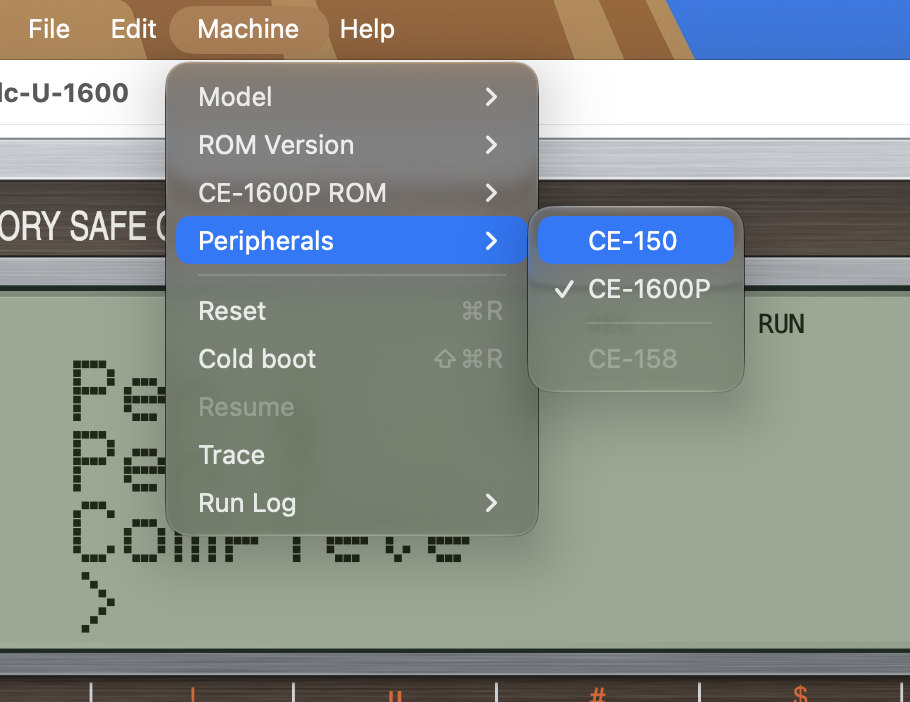
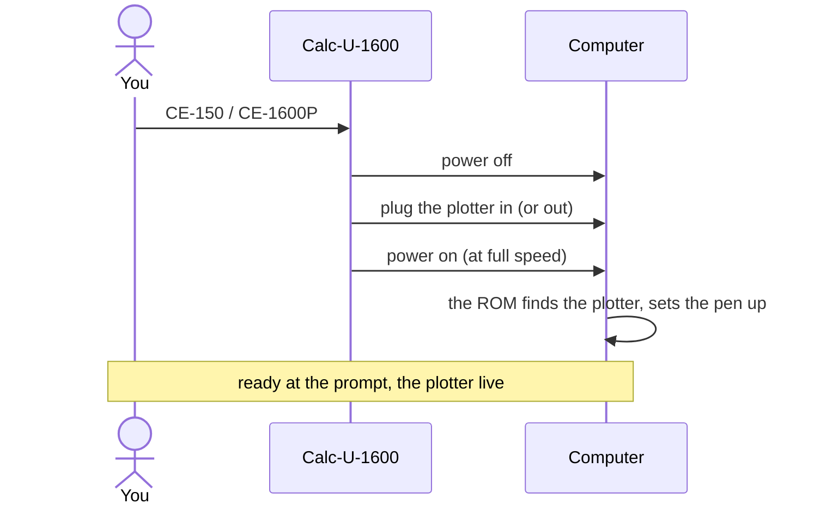
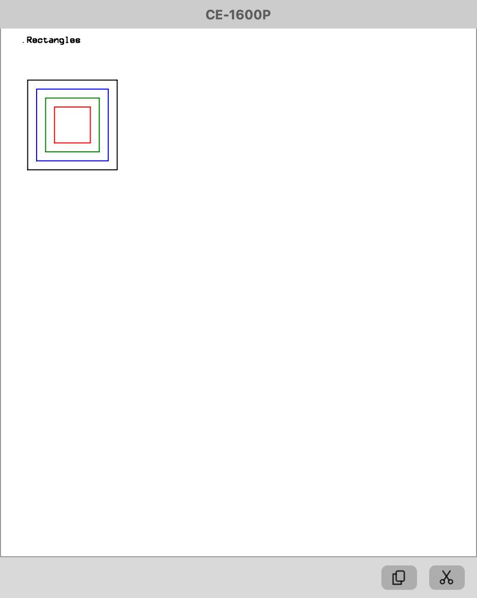
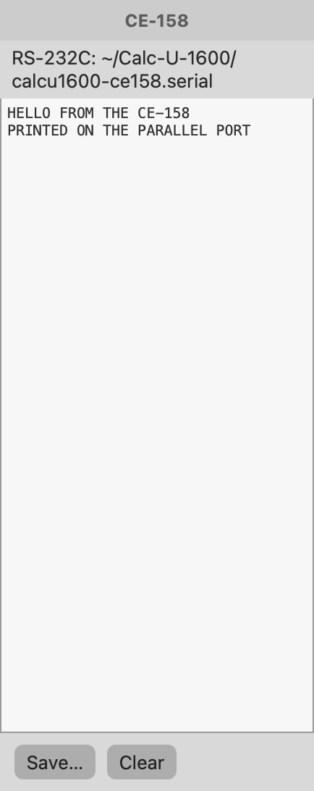

# Plotters and the CE-158

Places, attaching and detaching, the paper panel with Copy and Cut are the
family's; the [shared part of this chapter](../../../library/help/05-peripherals-and-paper.md)
describes them. This part covers Calc-U-1600's peripherals: the CE-150
and CE-1600P plotters and the CE-158 interface.

| Peripheral | Models | What it is |
|---|---|---|
| CE-150 | PC-1500, PC-1500A, PC-1600 | Four-colour pen plotter with a cassette interface |
| CE-1600P | PC-1600 | Four-colour pen plotter with a cassette interface and the CE-1600F floppy drive |
| CE-158 | PC-1500, PC-1500A, PC-1600 | Interface with a serial (RS-232C) and a printer (parallel) port |

On the PC-1600 the CE-150 is a plotter only: its cassette interface is
not available there.

They are plugged in and out with the control bar (the CE-150 and CE-158
buttons on the PC-1500 and PC-1500A; the printer picker and the CE-158
button on the PC-1600) or in **Machine ▸ Peripherals** (**More ▸
Peripherals** on mobile, where the bar has none of these controls). One plotter at a
time can be plugged in. The CE-1600P and the CE-158 cannot be used
together: plugging in one while the other is there is refused with a
notice.

On the real computers the ROM only notices a new peripheral when it
powers on, so plugging in or out goes through a power cycle:

## The plotters

The paper panel is always there; it shows the plotter's name while one is
plugged in, and empty paper without a name while none is. Each plotter
keeps its own paper until you cut it or load a preset that plugs it in:
through unplugging, a ROM or module change, a model switch (also from a
PC-1500 to a PC-1600) and a Reset or Cold boot, after which the next plot
goes on below what is drawn. A paper feed without a mark shows as blank
paper. The paper scrolls, and it follows the pen as long as you are at
the bottom. **Copy** and **Cut** are the two icons at the right of the row
below the paper (two sheets, scissors):

**Copy** puts the whole plot on the clipboard at its physical size, ready
to paste or print:

**Cut** copies the plot, then tears the paper off, so that the next plot
starts on a clean sheet.

The CE-1600P has its own ROM, New (the default) or Old, which the
CE-1600F floppy disk drive uses too. The control bar and the menus plug
it in with the New ROM; a preset or the harness can name the Old one.
**Machine ▸ CE-1600P ROM** (while it is plugged in) switches to the Old
one and back, keeping the disk in the drive, the same side up, and the
cassette. Unplugging the CE-1600P takes the disk out of the CE-1600F.

The CE-1600P has a cassette recorder, and so has the CE-150 on the
PC-1500 and PC-1500A (not on the PC-1600): while one with a recorder is
plugged in, the
control bar shows the cassette picker and the counter
([Loading a BASIC program](09-basic-programs.md)); unplugging it takes the
cassette out.

## The CE-158

The **CE-158** button or **Machine ▸ Peripherals ▸ CE-158** plugs in the
CE-158 interface, with a power cycle like the plotters. It works on all
three models.

- **Serial port:** the CE-158's port is a serial port file of your
  computer, `calcu1600-ce158.serial`, in the link folder (desktop only;
  [COM ports](09-com-ports.md) has how to use it and the settings).
- **Printer port:** whatever a program prints on the parallel port
  (`OPN "LPRT"`, then `LPRINT`) appears in the CE-158 panel. **Save…**
  writes it to a file exactly as it was sent; **Clear** starts a new
  sheet.

In BASIC:

- `OPN "LPRT"` sends `LPRINT` to the printer port, and `OPN` alone
  switches it back.
- `SETDEV PO` sends `LPRINT` and `LLIST` to the serial port instead, and
  `SETDEV KI` makes `INPUT` read from it.
- `OUTSTAT 0` switches the DTR and RTS lines on.

The full command set is in the
[CE-158 reference](https://github.com/tinue/SharpBasicReference/blob/main/CE-158-Reference.md).

Known gap: on the PC-1600, `SETDEV KI` with `INPUT` doesn't work yet;
`RINKEY$` does.
