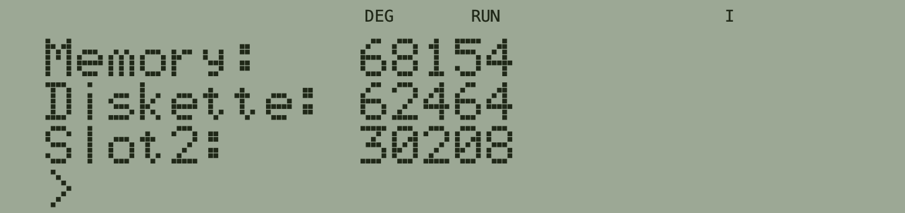

# Presets for Calc-U-1600

What a preset is, its header, its steps, waiting, `expect:` and startup
presets are the family's; the [shared part of this chapter](../../../library/help/06-presets.md)
describes them. This part covers what a preset of Calc-U-1600 holds: its
models and hardware, its programs, its steps, the examples and the
startup presets. The full list of the product's keys is
[Preset sections](10-preset-sections.md).

The file name ends with the model: `.pc1500`, `.pc1500a` or `.pc1600`.

## The smallest preset

```yaml
format-version: 2
model: PC-1500A
keys:
  - key: cl
  - type: NEW0
  - key: mode
  - type: PRINT "HELLO"
```

`key:` presses keys by their IDs, one after the other (`- key: shift up
up`); `type:` types a line, then ENTER. Everything after `type: ` is typed
as written, `#` and quotes included, so a `#` in BASIC (`PRINT #1`) stays.

A preset of version 1, written for Calc-U-1600 0.8 or earlier, is refused
with a hint; upgrade it by hand as the
[preset format, §9.2](https://github.com/tinue/calc-u/blob/main/docs/formats/preset.md#92-calc-u-1600-preset-version-1)
lists.

## Adding hardware

```yaml
format-version: 2
model: PC-1600:new            # PC-1500[:A01|A03|A04] | PC-1500A | PC-1600[:new|old]
printer: CE-1600P:new         # CE-150 (all models) | CE-1600P[:new|old] (PC-1600)
slot-1: { name: CE-1600M }    # a bundled or saved module, by name
```

- **Names** are Sharp's, with the hyphen, in any case: `CE-1600P`,
  `ce-1600p`.
- **By name or by file:** `slot-1: { name: … }` names a module,
  `slot-1: { file: … }` a `.card.yaml` file. Paths are relative to the
  preset; `~/` is your home folder.
- **PC-1500 and PC-1500A:** there is only `slot-1:`.
- **CE-158:** `interface: CE-158` (not together with the CE-1600P).
- **A folder as a drive (PC-1600):** `host-drive: { folder: … }`
  ([The host drive](09-host-drive.md)).
- **Nothing plugged in:** leave the key out.

A floppy disk and a tape are steps, since they change while the computer
runs ([below](#media-steps)).

## Loading a BASIC program

```yaml
format-version: 2
model: PC-1600
keys:
  - key: mode
  - type: NEW0
program:
  file: hanoi.bas             # converted and written straight into memory
keys:
  - key: mode
  - type: RUN
```

- **Before a `program:` section,** leave the computer in PRO mode after
  `NEW0`, as above, and switch to RUN mode afterwards. For a PC-1500
  program on the PC-1600, type `MODE1` first; for a program module,
  `INIT"S1:","P"` and `TITLE"S1:"`. The loader follows MODE and `TITLE`,
  as Load BASIC Program does.
- `file:` works like **File ▸ Load BASIC Program…**
  ([Loading a BASIC program](09-basic-programs.md)) and is fast: the file
  is a `.bas` listing, a tokenized `.bbin`, or a cassette WAV. What the
  file holds decides how it is loaded, as when you drop it on the window.
- `text: |` types the program line by line through the ROM's editor, the
  way you would. It is slow but works everywhere, and the program sits in
  the preset itself. `typed: true` next to a `file:` types a listing in
  the same way:

  ```yaml
  program:
    text: |
      10 PRINT "HELLO"
      20 GOTO 10
  ```

## Machine code

```yaml
program:
  file: memtest_bank.bin
  address: &7C01              # needed if the file has no header
# length: &200                # load only part of the file
```

- **Numbers:** `&`, `0x` or `$` makes a number hex; without one it is
  decimal. This holds for every number in a preset.
- **Files with a header** (PC-1600, CE-158) bring their own address.
- **PC-1600:** the loader places the code the way Load Machine Code does,
  by MODE, `TITLE` and the address: in MODE 1 `address:` is an LH5803
  address. Switch MODE or `TITLE` in a `keys:` section first.
- **Auto-run:** if the header has an auto-run address, the preset types
  `CALL` for you and waits until the code returns.

More on machine code is in [Machine-code programs](09-machine-code.md).

## Media steps

| Step | What it does |
|---|---|
| `- floppy: { name: Formatted }` | Puts a disk into the CE-1600F (PC-1600 with the CE-1600P), by `name:` or `file:`, with `side: 0` or `1` (default 0) |
| `- tape: { file: mytape.tape.yaml }` | Puts a tape into the cassette interface of the CE-150 or CE-1600P, by `name:` or `file:` |
| `- eject: floppy` / `- eject: tape` | Takes the disk or the tape out |
| `- saveas: { place: slot-1, as: live, name: My module }` | Name & Save the module in slot 1 into your save folder. `slot-2` and `floppy` are PC-1600 only |
| `- saveas: { place: slot-1, as: template, name: My module }` | The same, saved as a template |
| `- saveas: { place: slot-1, as: live, protected: true, name: My ROM }` | The same, with the module's write-protect switch on (the CE-161; not a disk) |
| `- saveas: { place: slot-2, as: template, file: Module.card.yaml }` | Saves to that file, next to the preset (`.card.yaml` for a module, `.floppy.yaml` for `place: floppy`); the name is the file name |

A preset that prepares a module and a disk and saves both as templates
next to itself, and the preset that uses them:
[make_diskworks_media.pc1600](https://github.com/tinue/calc-u/blob/main/products/calc-u-1600/examples/dwx/make_diskworks_media.pc1600)
and [DiskWorks.pc1600](https://github.com/tinue/calc-u/blob/main/products/calc-u-1600/examples/dwx/DiskWorks.pc1600).

## Other steps of this product

| Step | What it does |
|---|---|
| `- expect: 11834` | Stops the preset with an error unless one line of the display contains that text. A backslash is written `\\`, a character outside ASCII `\xHH` (its code); between slashes (`/ERROR 1\b/`) the text is a regular expression |
| `- screenshot: shot.png` | Saves the LCD's picture, as Copy Screen does, in the save folder; in the browser it is a download |
| `- syncclock:` | Sets the computer's clock from your computer's. Put it last: a preset runs at full speed, so the clock runs ahead |
| `- trace: run.bin` / `- trace: off` | Starts or stops a CPU trace ([Debugger](07-debugger.md)) |
| `- cut-paper:` | Cuts the paper of the plotter that is plugged in |

The debugger steps of the family (`pause:`, `step:`, `resume:`) are not
available on the Sharp models.

**Key IDs for `key:`:** a single letter, digit, or `+ - * / = ( ) .`;
`enter`, `space`, `cl`, `mode`, `shift`, `def`, `sml`, `rcl`, `rsv`,
`off`, `up`, `down`, `left`, `right`, `f1`–`f6`, and `on` (or `break`).
The PC-1600's `ctrl`, `kbii` and `bs` can't be pressed from a preset.

## The examples

The presets Calc-U-1600 comes with are under **File ▸ Examples**, in the
groups BASIC, Plotter and Machine code, by their description. Every
example, also those not bundled, is in the
[examples folder](https://github.com/tinue/calc-u/tree/main/products/calc-u-1600/examples)
of the source repository; download it to open the files with **File ▸
Load Preset…**.

## Startup presets

**Settings ▸ Startup presets** sets one preset per model (the keys
`[preset] PC-1500`, `[preset] PC-1500A`, `[preset] PC-1600`,
[Settings](08-settings.md)). Each model's list offers the startup presets
the product comes with, by description; **Choose…** takes a preset file of
your own. A model switch starts with no modules and no peripherals, so a
startup preset is how a model gets its usual hardware.

The PC-1600's bundled startup preset:

1. plugs in the CE-1600P, with the bundled Formatted disk in the drive, a
   CE-1600M in slot 1 and a CE-1601M in slot 2;
2. formats and splits the CE-1601M as a RAM disk (`INIT"S2:","F"`,
   `INIT"S2:","M"`);
3. sets up `COM1:` as in [COM ports](09-com-ports.md);
4. puts `SAVE"COM1:"@` and `LOAD"COM1:"@` on the F1 and F2 keys;
5. shows the free memory, then sets the clock.

This is what it leaves on the LCD:


