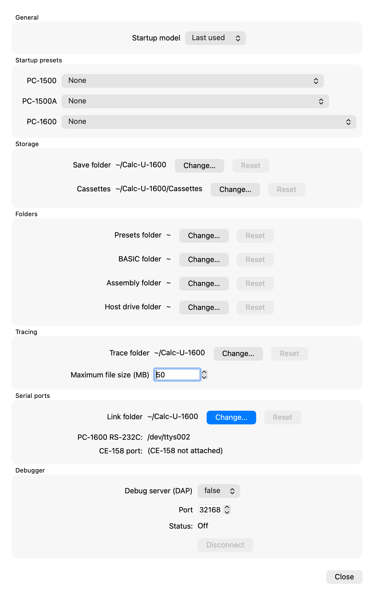

# Settings of Calc-U-1600

The settings file, where it lies, and the keys every product of the family
has are described in [Settings](../../../library/help/08-settings.md). This
page lists what Calc-U-1600 adds: its file's name, the names it gives the
family's keys, and its own keys.

Calc-U-1600's settings file is `Calc-U-1600.ini`. **File ▸ Settings…**
opens the settings dialog; a change applies at once.

## The dialog

- **General ▸ Startup model:** the model to start with: the one used last,
  PC-1500, PC-1500A or PC-1600 (`[startup] model`).
- **Startup presets:** one per model, see
  [Startup presets](#startup-presets) below.
- **Storage ▸ Save folder** and **Cassettes:** where your saved modules, disks
  and cassettes go ([Media](04-media.md)).
- **Folders:** where the file dialogs start, see [Folders](#folders).
- **Tracing:** the trace folder and the size limit of a trace (the
  family's keys).
- **Serial ports ▸ Link folder:** where the serial port files go, with
  their current paths while the ports are open
  ([COM ports](09-com-ports.md)). Not on Windows.
- **Debugger:** the debug server for VS Code, its port, its status, and
  **Disconnect** ([Debugger](07-debugger.md)).

The Web frontend shows the startup model and the startup presets only; it
keeps your modules, disks and cassettes in the browser's storage for the page.

## Startup presets

`[preset] <model>` of the family has one key per model here:

- `[preset] PC-1500`: the startup preset of the PC-1500; empty: none.
- `[preset] PC-1500A`: the startup preset of the PC-1500A; empty: none.
- `[preset] PC-1600`: the startup preset of the PC-1600; empty: none.

A startup preset is applied at each start and each switch to its model
([Presets](06-presets.md)).

## Folders

`[folders] <kind>` of the family has four kinds here. Each is where a file
dialog starts: the folder last used (written by the app), or a fixed folder
given as `fixed:<folder>`.

| Key | Dialog label | Where it applies |
|---|---|---|
| `[folders] presets` | Examples folder | **File ▸ Load Preset…** |
| `[folders] basic-programs` | Basic folder | **File ▸ Load BASIC Program…** |
| `[folders] machine-code` | Assembly folder | **File ▸ Load Machine Code…** |
| `[folders] host-drive` | Host drive folder | **File ▸ Mount Directory…** (the folder last mounted by default) |

## Debug server

- `[debug] dap-enabled`: the debug server for VS Code (DAP, on 127.0.0.1
  only): `true` or `false`; `false` by default. In the dialog: **Debugger ▸
  Debug server (DAP)**.
- `[debug] dap-port`: the port of the debug server, 1024 to 65535; any other
  value counts as missing, and the port is 32168. In the dialog:
  **Debugger ▸ Port**.

Starting Calc-U-1600 with `--dap <port>` turns the server on for that run only
and leaves both keys as they are ([Debugger](07-debugger.md#one-time-installation)).

## Window

`[window] <key>` of the family has two keys here:

- `[window] width`: the window's width, written by the app; 900 by
  default.
- `[window] height`: the window's height, written by the app; 500 by
  default.
