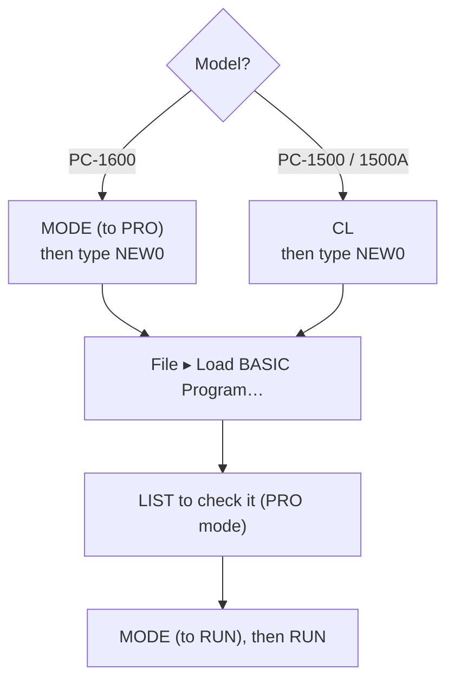
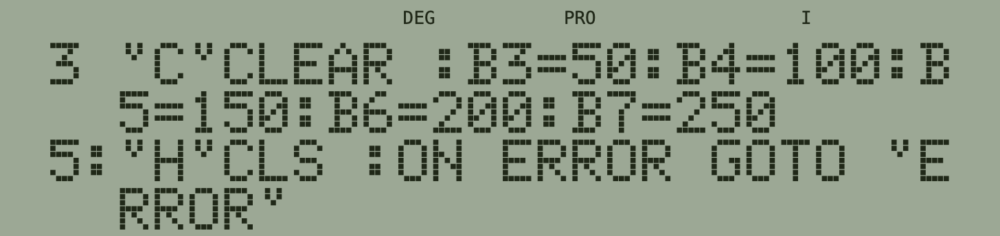
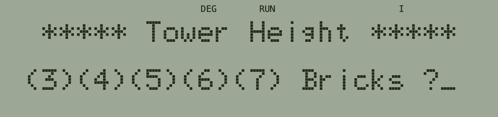

# BASIC programs and the cassette

## Loading a BASIC program

**File ▸ Load BASIC Program…** opens a plain-text BASIC listing (`.bas`), an
already tokenized program (`.bbin`, as Sharp-Data-Exchange's `sde convert`
writes it, with a CE-158 or PC-1600 header), or a cassette WAV
([below](#fast-loading-a-cassette-wav)), converts a listing to BASIC's
internal form, and writes the program straight into the program memory. It
behaves like the real `LOAD`: it doesn't reset the machine, change the mode,
or run `NEW` for you. So prepare the machine the same way you would for
`LOAD`:

Right after loading, `LIST` in PRO mode shows the program:

and `RUN` starts it:

Good to know:
- **Where the program goes.** It goes to the same place a `LOAD` would put
  it: on a PC-1600, into the program area `TITLE` selects. That is S0
  (internal RAM, plus a RAM module folded into it), or a program module
  after `INIT"S1:","P"` and `TITLE"S1:"`. Across a module's 16 KB banks
  lines are never split, just as the calculator itself stores them.
- **MODE decides how the listing is read (PC-1600).** In MODE 0 it is
  PC-1600 BASIC; in MODE 1 it is PC-1500 BASIC, so a PC-1500 listing's
  `CALL` becomes the PC-1500 `CALL` (which the PC-1600 lists as `XCALL`),
  exactly as if the program had been saved on a PC-1500 and loaded with
  `CLOAD`. A listing the PC-1500 can't hold (for example one with `ä`) is
  refused in MODE 1. PC-1600-only keywords stay plain text in MODE 1 and
  fail when the program runs.
- **Tokenized files carry their machine.** A PC-1600 `.bbin` loads in both
  MODEs, as with the calculator's own `LOAD`. A PC-1500 one (CE-158 header)
  loads on a PC-1500 or PC-1500A, and on a PC-1600 in MODE 1 only.
- **Any way in.** Machine code is refused here with a pointer to
  [Load Machine Code…](09-machine-code.md), and a BASIC program is refused
  there. Dropping the file onto the window, or choosing it in
  **File ▸ Load Preset…**, opens it as what it is and picks the right loader
  for you ([Media](../../../library/help/04-media.md)).
- **Nothing is switched for you.** Calc-U-1600 never changes MODE or `TITLE`;
  set them first, as on the real calculator.
- **Single lines.** **Edit ▸ Paste Text** types the clipboard's text through
  the keyboard ([Getting started](../../../library/help/02-getting-started.md)).
  That's handy for a long command or one program line, but not for a whole
  program.
- **In a preset,** `program:` loads a BASIC program or types it line by
  line ([Preset sections](10-preset-sections.md)).
- **No export.** Calc-U-1600 doesn't export programs as files. Use the machine's
  own `SAVE` to a memory module or a floppy disk. To get a program onto your
  computer, `CSAVE` it to a [cassette](#the-cassette-cload-and-csave), `SAVE` it
  to a [folder mounted as a drive](09-host-drive.md) (PC-1600) or over
  `COM1:` ([COM ports](09-com-ports.md)).

### Fast-loading a cassette WAV

**File ▸ Load BASIC Program…**, **File ▸ Load Machine Code…** and a drop also
open a cassette WAV of a PC-1500 or PC-1500A (CE-150) or PC-1600 (CE-1600P,
MODE 0): a real recording or one Calc-U-1600 saved. The tape is decoded at
once (by libsharpdx, the same code as `sde get tape.wav`) and the file on it
is written straight into memory, like a `.bbin` or `.bin`: no `CLOAD`, no
waiting for the tape. If the tape holds several files, a list asks which
one; a machine-code file goes to the machine-code flow. Recordings may be
quiet, noisy, a little fast or slow, or at any sample rate; a file is only
loaded when all of its checksums match, otherwise the message says what is
damaged and where on the tape.

This is not the cassette below: that plays the tape to the emulated
interface in real time, and the ROM's `CLOAD` reads it.

## The cassette: CLOAD and CSAVE

The CE-150 and the CE-1600P (PC-1600) have the jacks of a cassette
recorder. On a PC-1600 the CE-150's cassette works in MODE 1, with
PC-1500 tapes; in MODE 0 the PC-1600 refuses `CLOAD` and `CSAVE` through
it (ERROR 110), as the real one does. A cassette is a medium ([Media](04-media.md)): a
**cassette definition** (`<name>.cassette.yaml`: its name, a description,
and the sound file it uses) with the sound of its tape, a WAV file beside
it, in the cassette folder (**File ▸ Settings… ▸ Storage ▸ Cassettes**,
`Cassettes` in the save folder by default). The cassette controls sit on
the control bar whenever one of them is plugged in. The
recorder starts empty, and detaching its interface takes the cassette
out. You put a cassette in, then type the command as on the real
machine:

- **To load,** pick a cassette from the **Cassette** list. It goes in rewound.
  Type `CLOAD`, `CLOAD "name"`, `CLOAD M` or `CLOAD?`. A second `CLOAD`
  reads on from where the first one stopped, as on a real tape.
- **To save,** pick **Blank** from the **Cassette** list and type
  `CSAVE "name"` (or `CSAVE M`). Another `CSAVE` goes after it on the same
  tape. The blank cassette is a template: what you record stays in the
  recorder until you keep it with **Name & Save**, the save button next
  to the list (or take the cassette out). If a cassette of that name
  exists, you're asked before it is replaced.
- **(empty)** is no cassette: a `CSAVE` then records nothing.

A cassette keeps its role: one you saved plays, the blank one records. To play back what you recorded, pick it from the list; that
also takes the recording cassette out. "(empty)" takes a cassette out. The counter shows
▶ and the tape position while playing, ● and the length recorded while
recording, and a dimmed 0:00 without a cassette. It turns green while the
motor runs:

Good to know:
- **The calculator runs the motor.** As with a real CE-152 on the remote
  jack, the tape moves only while the calculator's remote relay is on: from
  the moment it starts `CLOAD` or `CSAVE` until it's done. A cassette put in
  early simply waits.
- **Real time or faster.** The tape runs in the calculator's own time, so
  you hear `CSAVE` (and see the counter) at the real speed. Pressing and
  holding the LCD runs everything faster as usual, sound off; the WAV comes
  out the same.
- **Interchangeable WAVs.** The sound files are standard 48 kHz, 16-bit
  WAVs. Calc-U-1600 plays any PCM WAV, 8 to 32 bits, mono or stereo: recordings
  of a real calculator, or files made with Pocket Tools' `bin2wav` and read
  with its `wav2bin`. A WAV on its own is not a cassette: write a small
  cassette definition next to it ([Media files](10-media-files.md)), and it is
  listed. Opened or dropped on its own, a WAV is loaded as a program, as
  above.
- **The buzzer sounds the tape** while saving and loading, as on the real
  machines.
- **Leave a long lead-in.** After switching on the motor the calculator
  waits about half a second for the recorder, then needs a few seconds of
  lead-in tone. A tape made with `bin2wav` therefore needs `-s 3` (a 3 s
  lead-in) or `-l 0x400` (gap and lead-in as long as the calculator's own);
  its default (0.5 s on the PC-1500, 2.1 s on the PC-1600) is too short.
  The calculator's own `CSAVE` writes a long lead-in.
- **Formats.** The PC-1500 reads and writes PC-1500 tapes. The PC-1600 in
  MODE 0 reads and writes PC-1600 tapes. Not yet supported: the PC-1600
  reading PC-1500 tapes in MODE 1 (`CLOAD` through the CE-1600P).
- **In a preset** the step `cassette:` puts a cassette in and `eject: cassette` takes it
  out ([Presets](06-presets.md)).
