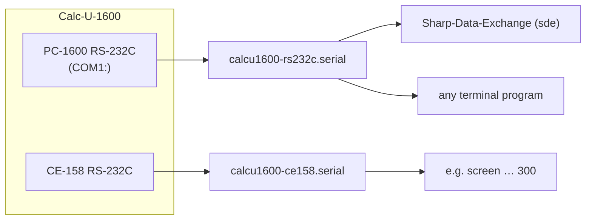
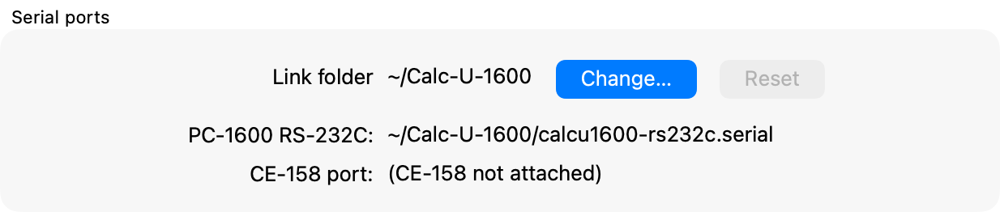

# COM ports

Calc-U-1600 connects the calculators' serial ports to **serial port files**
on your computer. These are pseudo-terminals that any serial program can
open like a real port:



Both files are in the link folder (**File ▸ Settings… ▸ Serial ports ▸ Link
folder**, `[serial] link-folder`; the save folder, `~/Calc-U-1600`, by
default). The settings dialog also shows their full paths while the ports
are open:



Serial ports work on macOS and Linux; on Windows and in the Web frontend they
are not available.

## PC-1600: the built-in RS-232C port

The port is always on while a PC-1600 is running. Set it up on the
calculator once after each power-on or reset:

```basic
SETCOM "COM1:",9600,8,N,1,N,N
INIT "COM1:",4096
OUTSTAT "COM1:"
RCVSTAT "COM1:",28
SNDSTAT "COM1:",28
```

This is 9600 baud, 8 bits, no parity, 1 stop bit, and **no handshake**.
XON/XOFF (`…,X,N`) doesn't work well here: the control characters simply
become part of the data, because no driver on the computer side reacts to
them. `28` switches the handshake-line checks off.

**Exchanging programs with Sharp-Data-Exchange**
([github.com/tinue/Sharp-Data-Exchange](https://github.com/tinue/Sharp-Data-Exchange)):

```sh
# computer → PC-1600: start LOAD "COM1:" on the calculator, then
sde put myprogram.bas --device pc1600emul --port ~/Calc-U-1600/calcu1600-rs232c.serial

# PC-1600 → computer: start this first, then SAVE "COM1:" on the calculator
sde get myprogram.bas --device pc1600emul --port ~/Calc-U-1600/calcu1600-rs232c.serial
```

To avoid typing `--port` every time, store the folder once:
`sde config set pc1600emul.port ~/Calc-U-1600`. sde's own default is
`/tmp`, which is not where Calc-U-1600 puts the file.

## CE-158: serial and printer port

The **CE-158** button on the control bar attaches the CE-158 interface, with
a power cycle like every peripheral ([Peripherals](05-peripherals.md)). It
works on all three models. The CE-158 and the CE-1600P cannot be used
together: attaching one while the other is attached is refused.

- **Serial port:** `calcu1600-ce158.serial` runs at 300 baud by default, for
  example `screen ~/Calc-U-1600/calcu1600-ce158.serial 300`.
- **Printer port:** whatever the program prints on the parallel port
  (`OPN "LPRT"`, then `LPRINT`) appears in the CE-158's panel
  ([Peripherals](05-peripherals.md)).

In BASIC:
- `OPN "LPRT"` sends `LPRINT` to the printer port, and `OPN` alone switches
  it back.
- `SETDEV PO` sends `LPRINT`/`LLIST` to the serial port instead, and
  `SETDEV KI` makes `INPUT` read from it.
- `OUTSTAT 0` switches the DTR/RTS lines on.

The full command set is in the
[CE-158 reference](https://github.com/tinue/Sharp-BASIC-Ref/blob/main/PC-1500-BASIC-Reference.md#ce-158-serialparallel-interface).

Known gap: on the PC-1600, `SETDEV KI` + `INPUT` doesn't work yet.
`RINKEY$` does.

## Without a window

The harness `calcu` feeds and captures both ports in emulated time, without
a serial port file unless you ask for one:
`calcu --product c1600 c1600 serial ce158|rs232c feed <file>`,
`capture <file>`, `link` (makes the serial port file) and `report`. It is
built from the source repository
([Building](https://github.com/tinue/Calc-U/blob/main/docs/Building.md)).
