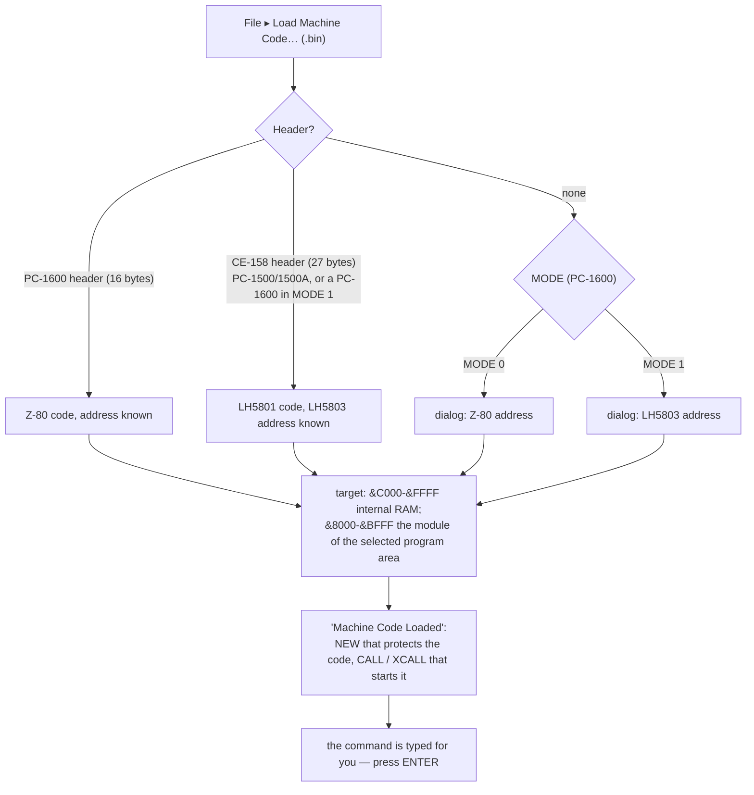
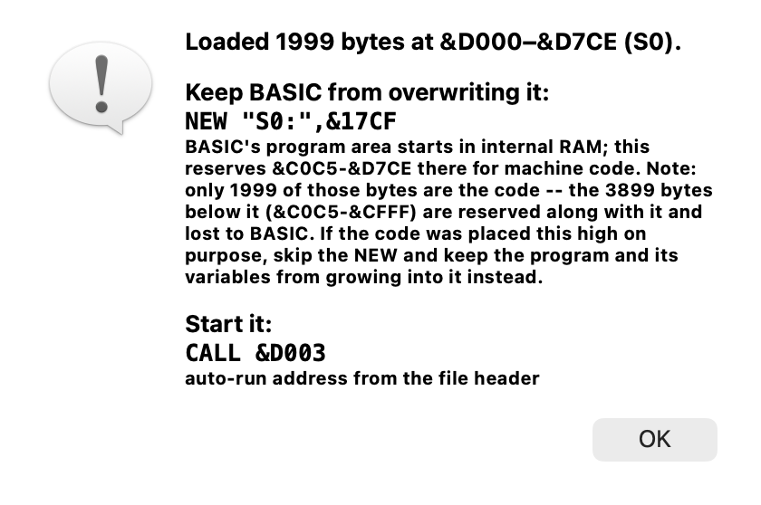

# Machine-code programs

**File ▸ Load Machine Code…** opens a `.bin` file (or a machine-code file on
a cassette WAV, see [BASIC programs](09-basic-programs.md#fast-loading-a-cassette-wav))
and writes it into the calculator's memory. It never runs the code. On a
PC-1600 the calculator's MODE and the program area `TITLE` selects decide
where it goes and which CPU it is for; Calc-U-1600 never changes them. What
happens next depends on the file:

A file without a header needs a start address. On a PC-1600 the dialog says
which address space it expects: in MODE 0 a Z-80 address (Z-80 code is
assumed), in MODE 1 an LH5803 address as on a PC-1500 (LH5801 code is
assumed; the internal RAM is &4000-&7FFF there). For every address that
holds, the dialog says where the code goes: the internal RAM, a module, or
the work area. An address in the work area (&F000-&FFFF, LH5803
&7000-&7FFF) is allowed with a warning that says what lies there. Many
programs live at the top, in the area of the CE-1F01A bar-code reader pen
(&FF40-&FFFF); `CLOCK.BIN`, for example, loads at &FF3A and so also covers
part of the WAKE$ strings. The PC-1500A's machine-code area &7C01 is
PC-1600 system work area, one reason the PC-1600 is compatible with the
PC-1500 only.

On a PC-1500, a load that meets a byte that is not RAM writes nothing. After loading, Calc-U-1600 tells you two things:
- which `NEW` keeps BASIC from overwriting the code: `NEW "S0:",size` in
  MODE 0, `NEW &addr` the PC-1500 way in MODE 1, `NEW "S1:",size` for code
  in a selected program module;
- how to start it: `CALL` for Z-80 code, `XCALL` for LH5801 code. The
  command is already typed on the calculator, so you only have to press
  ENTER.

To load code into a program module, select it first (`TITLE"S1:"`); to load
several files in one go, use a preset: its `program:` section takes
machine code too ([Preset sections](10-preset-sections.md)).

**Debugging.** With the debug server on (**File ▸ Settings… ▸ Debugger**),
VS Code can attach to Calc-U-1600 and debug the program. It can build, load
and start the program; stop at breakpoints in your `.asm` source; step
through it; and show registers and memory. It also works for ROM code. See
[Debugger](07-debugger.md).
