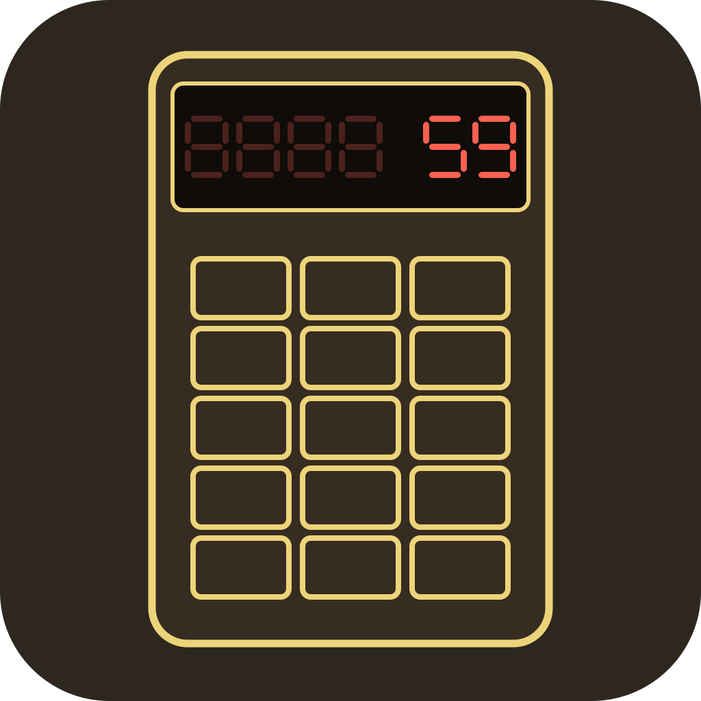
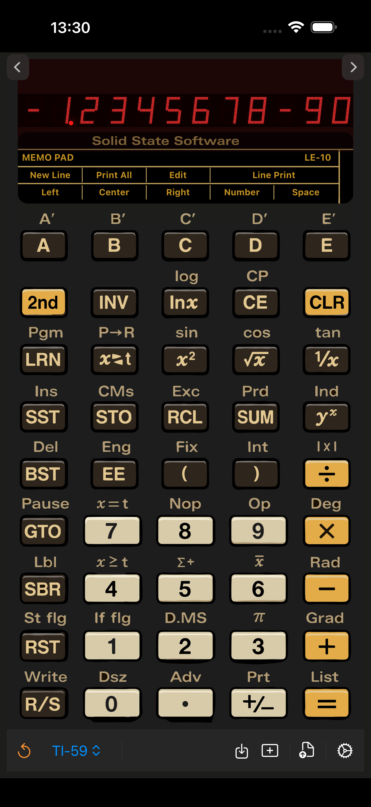

# Calc-U-59

Calc-U-59 is an emulator of the **TI-59**, the **TI-58** and the
**TI-58C**, the programmable calculators Texas Instruments built from
1977. It runs on macOS, Windows, Linux, the iPhone and the iPad, and in
the browser. It runs the calculators' original ROM through an emulated
processor, at the original speed, so every result, the flashing overflow
display and the documented quirks behave as on the real calculator. The
display even looks as the eye saw the real one, dimming while the
calculator works.

What Calc-U-59 emulates:

- the **TI-59, TI-58 and TI-58C**, each with its memory partition and its
  state after switching on ([Models and machine
  control](../../../library/help/03-models-and-machine-control.md),
  [What differs by model](09-models.md));
- all fourteen **Solid State ROM modules**, from the Master Library to
  the RPN Simulator ([Solid State ROM modules](09-modules.md));
- **magnetic cards** for the TI-59, read and written as files
  ([Magnetic cards](04-magnetic-cards.md));
- the **PC-100C** print cradle, with its paper as dots and as text that
  can be copied ([The PC-100C printer](05-printer.md));
- the **TI-58C's constant memory**, kept between starts
  ([Constant memory](09-constant-memory.md));
- a **debugger** at the level of program steps and of the processor's
  instructions, with traces for analysis afterwards
  ([Debugger](07-debugger.md));
- **presets**: plain text files that set up a calculator with a program,
  its registers, a cue card and a module in one go
  ([Presets](06-presets.md)).

You can try it in the browser at
[calc-u.org/59/play/](https://calc-u.org/59/play/) before you install
anything; how to install it on each system is in
[Installing Calc-U-59](02-installing.md).

## The three models

| Model | Introduced | What it is |
|---|---|---|
| TI-59 (TI Programmable 59) | May 1977 | The top of the range: up to 960 program steps or 100 data registers, traded against each other in steps of 80 and 10, and a magnetic card reader in the side. Its memory is lost when it is switched off, unless the program is on a card |
| TI-58 (TI Programmable 58) | May 1977 | The same calculator with half the memory, up to 480 steps or 60 registers, and no card reader. Solid State ROM modules work as on the TI-59 |
| TI-58C (TI Programmable 58C) | 1979 | A TI-58 with constant memory: programs and registers survive switching off |

You choose the model in the model picker at the left of the control bar
or under **Machine ▸ Model ▸**.

## The calculators

The TI-59 was Texas Instruments' flagship programmable calculator, sold
for around $300 from 24 May 1977. It followed the SR-52, and for the
rest of the decade it was the calculator engineers, surveyors,
navigators and financial analysts carried. You program it by recording
keystrokes: in learn mode every key you press becomes a program step,
and the ten user-defined keys, **A** to **E** and their second functions
**A′** to **E′**, are the entry points. The instruction set has
conditionals, loops, subroutines and indirect register addressing.

These calculators use **AOS**, the Algebraic Operating System: you enter
an expression roughly as it is written on paper, with up to nine levels
of parentheses, and the calculator applies the precedence of the
operators when you press **=**. The pending operations have edge cases
that come out right only when the original ROM runs, which is what
Calc-U-59 does. One of the modules, the **RPN Simulator**, makes the
calculator behave like one with reverse Polish notation.

### Magnetic cards and banks

The TI-59's card reader takes small magnetic strips; a side holds one
**bank**, a fixed quarter of the 960-step memory: 240 steps or 30 data
registers. Program steps fill the memory from the bottom, data
registers from the top, so R00 is the last register of bank 4.
**n 2nd Op 17** moves the boundary between them in steps of ten
registers (80 program steps), and a bank holds whatever falls into its
quarter: steps, registers or both.

| n Op 17 | Partition | Bank 1 | Bank 2 | Bank 3 | Bank 4 |
|---|---|---|---|---|---|
| 0 | 959. | 000–239 | 240–479 | 480–719 | 720–959 |
| 1 | 879.09 | 000–239 | 240–479 | 480–719 | 720–879, R09–R00 |
| 2 | 799.19 | 000–239 | 240–479 | 480–719 | 720–799, R19–R00 |
| 3 | 719.29 | 000–239 | 240–479 | 480–719 | R29–R00 |
| 4 | 639.39 | 000–239 | 240–479 | 480–639, R39–R30 | R29–R00 |
| 5 | 559.49 | 000–239 | 240–479 | 480–559, R49–R30 | R29–R00 |
| 6 | 479.59 | 000–239 | 240–479 | R59–R30 | R29–R00 |
| 7 | 399.69 | 000–239 | 240–399, R69–R60 | R59–R30 | R29–R00 |
| 8 | 319.79 | 000–239 | 240–319, R79–R60 | R59–R30 | R29–R00 |
| 9 | 239.89 | 000–239 | R89–R60 | R59–R30 | R29–R00 |
| 10 | 159.99 | 000–159, R99–R90 | R89–R60 | R59–R30 | R29–R00 |

The display shows the partition as last step.last register; 479.59 (6
Op 17) is the TI-59's partition after switching on. A card side is
also what the cue card is: once read, the real card slid into a slot
above the keys, where the labels on its top edge named the keys **A** to
**E** of the program you had loaded. Calc-U-59 shows that card above the
keys too ([Cue cards](09-cue-cards.md)).

### Modules and the printer

The TI-58 and TI-59 were the first handheld calculators with removable
ROM program modules. A module held up to 5,000 program steps and ran
straight from its ROM, leaving the user's memory free. The Master
Library came in the box; Applied Statistics, Surveying, Aviation, Marine
Navigation and the others were sold separately. Calc-U-59 has all
fourteen.

The calculator docked into a thermal printer, the PC-100A, B or C. Beyond
printing results, it listed a program with mnemonics instead of key
codes, printed the data registers, and traced a program as it ran.
Calc-U-59 emulates the PC-100C, its paper included.

For the original manuals, program libraries and the wider community,
start at [ti59.com](https://www.ti59.com/) and
[datamath.org](http://www.datamath.org/SCI/WEDGE/TI-59.htm). This help
documents the emulator.

## Free software

Calc-U-59 is free software under the GNU GPL version 3; its source is in
the repository [tinue/calc-u](https://github.com/tinue/calc-u) on
GitHub.
