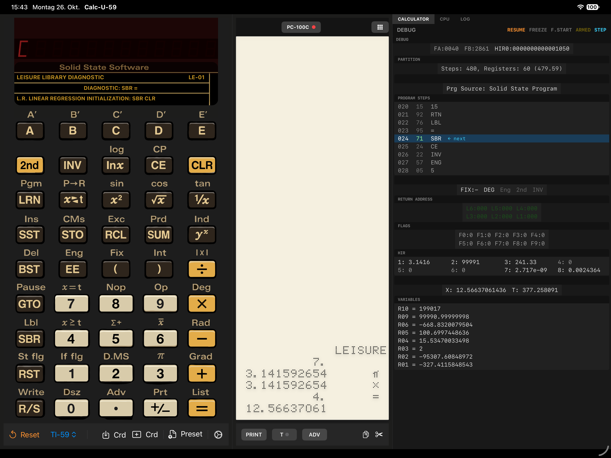

# Getting started with Calc-U-59

The window, the control bar, the menus and the settings dialog are the
family's; the [shared part of this chapter](../../../library/help/02-getting-started.md)
describes them ([the window](../../../library/help/02-getting-started.md#the-window),
[the menus](../../../library/help/02-getting-started.md#the-menus),
[without a menu bar](../../../library/help/02-getting-started.md#without-a-menu-bar),
[the control bar](../../../library/help/02-getting-started.md#the-control-bar)).
This part shows what they hold on the TI-59, the TI-58 and the TI-58C,
and how the window looks on each system. How to install Calc-U-59 is in
[Installing Calc-U-59](02-installing.md).

Calc-U-59 starts with the model you chose as the startup model, the
TI-59 the first time, with the Master Library module and no printer,
or with the startup preset you set for that model
([Presets](06-presets.md)). The calculator is on at once.

## The calculator

The window's main part is the calculator: the red LED display at the
top, the cue card below it, and the keys. The cue card names the keys
**A** to **E** and **A′** to **E′** for the program that is loaded: a
library program's own card, a magnetic card, or a cue card a preset
fits ([Cue cards](09-cue-cards.md)).

- Click or touch a key to press it. A key stays the one you pressed
  first; moving the pointer onto another key does not move the press.
- **Press and hold the display** to run the calculator at full speed,
  for a long program or a long listing on the printer; it runs at
  regular speed again when you let go.
- The display can draw its segments **Modernized** or **Classic**
  (Settings ▸ Display ▸ Segment Style).

## The control bar

The control bar below the calculator holds, from left to right:

1. the **model picker**: TI-59, TI-58, TI-58C;
2. the **module picker** of the module slot: the fourteen Solid State
   ROM modules and the empty slot ([Solid State ROM modules](09-modules.md));
3. the button **PC-100C**, which attaches or detaches the printer
   ([The PC-100C printer](05-printer.md));
4. on the TI-59 only, the two **Crd** buttons, Arm Card and Arm Fresh
   Card, and **Eject Card** in their place while a card passes the reader
   ([Magnetic cards](04-magnetic-cards.md)). On an iPad or iPhone, where
   the calculator stands beside the paper and the bar is wider than the
   calculator, these buttons are left out; a card armed in another
   layout (turned, or folded) is still fed by touching its corner.

Changing the module, or attaching or detaching the PC-100C, goes through
a power cycle, as on the real calculator ([What differs by
model](09-models.md)). While a preset loads, the model, module, printer
and card controls are disabled.

## The menus

Where the window has a menu bar (macOS, Windows, Linux, the browser's
wide layout):

| Menu | Items |
|---|---|
| File | Load Preset…; Examples ▸; on the TI-59 Arm Card… and Arm Fresh Card…; in the browser Import Media… and Saved Media…; Settings…; Quit |
| Machine | Model ▸; Peripherals ▸; Reset; Cold boot; Resume |
| Help | Calc-U-59 Help; About Calc-U-59 |

Calc-U-59 has no Edit menu: it has neither Copy Screen nor Paste Text.
On macOS, Settings…, About and Quit are in the application menu, and the
menus Edit, View and Window that macOS gives every app stay. The
shortcuts are those of the family: Load Preset… Ctrl+O (⌘O), Reset
Ctrl+R (⌘R), Cold boot Ctrl+Shift+R (⇧⌘R).

Where there is no menu bar (the iPhone, the iPad, the browser's
portrait layout), the control bar keeps the buttons **Reset**,
**Preset** and **Settings**, and the **More** button (⋯) holds
Examples ▸, the media items (in the browser), Cold boot, which asks
first, Resume, Calc-U-59 Help, and About in the browser. On the iPad,
the menu bar iPadOS gives an app shows the same menus as on macOS.

**Help ▸ Calc-U-59 Help** opens [calc-u.org/59](https://calc-u.org/59/) in
your browser.

## The window on each system

- **macOS** (the Swift app): the calculator, the paper panel and the
  debug panel side by side.
- **Windows and Linux** (the Qt6 app): the calculator, the paper panel
  and the debug panel side by side, with dividers you can move; the
  window comes back at its last size and place.
- **iPhone**: portrait only. The calculator fills the screen; the
  printer and the debugger are pages you turn with the arrows in the top
  corners (the debugger only with Settings ▸ Layout ▸ Debug Page in
  Portrait).
- **iPad**: in landscape, at least 820 by 560 points, the calculator, the
  paper and the debugger side by side as on the Mac; in a smaller
  landscape window the calculator and the paper; in portrait the pages
  of the iPhone. An iPhone that opens flat shows them side by side as on
  the iPad.
- **The browser** ([calc-u.org/59/play/](https://calc-u.org/59/play/),
  or installed as an app): the **wide** layout with the menu bar, the
  paper and the debugger; the **portrait** layout with the More button,
  the paper as a second page. An installed app follows the device's
  rotation.

## Your keyboard

On a computer you can type on the calculator with your keyboard: the
digits, the operation keys, **A**–**E**, **EE** and the parentheses,
with **Shift** and a letter for **A′**–**E′**. In the browser, click the
calculator first; a golden outline shows that it has the keyboard. The
whole table is the [keyboard map](10-keyboard-map.md).

## Opening files

A file you drop on the window, open with the product or name when you
start it is opened as what it is
([Media](../../../library/help/04-media.md#opening-and-dropping-files)):

| File | What happens |
|---|---|
| a preset (`.ti59`, `.ti58`, `.ti58c`) | it is loaded ([Presets](06-presets.md)) |
| a magnetic card (`.magnetcard.yaml`) | it is fitted, on the TI-59 ([Magnetic cards](04-magnetic-cards.md)) |
| a keystroke program (`.keystrokes.yaml`) | its program goes into the running calculator, without a cold boot ([Keystroke program files](10-keystroke-programs.md)) |
| an ASM overlay (`.asm`) | it is put over the ROM ([Debugger](07-debugger.md)) |
| a Solid State ROM module file, the constant memory file | refused with a notice |

On Windows the installer makes Calc-U-59 open presets with a double
click; on Linux, name the file on the command line.
