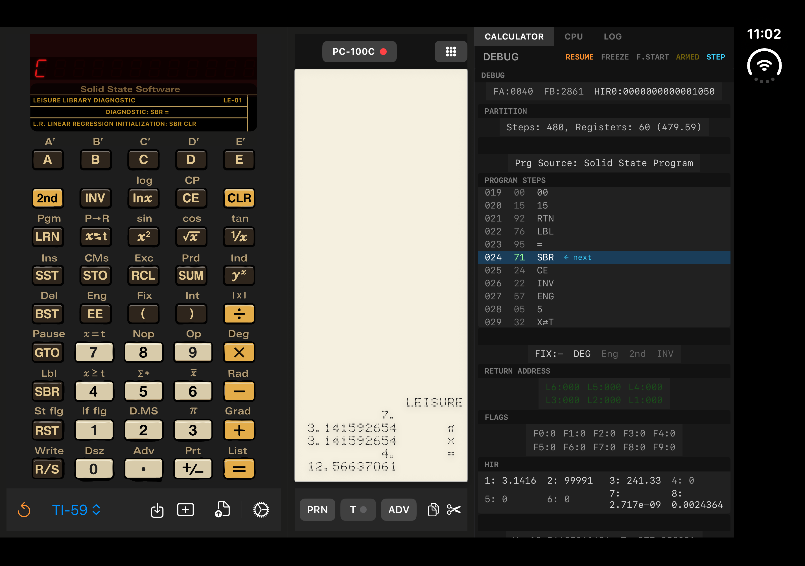

# The PC-100C printer

Calc-U-59 has two places for peripherals on every model: the **printer**
place, where the PC-100C print cradle goes, and the **module slot**, where
a Solid State ROM module goes ([Solid State ROM
modules](09-modules.md)). What every product does with peripherals and
paper is in the [shared part of this
chapter](../../../library/help/05-peripherals-and-paper.md); this part
shows the PC-100C.

## Attaching the printer

The button **PC-100C** on the control bar attaches and detaches the
printer; its dot shows whether it is attached. **Machine ▸ Peripherals ▸**
and a preset's `printer: PC-100C` do the same. Without a startup preset,
Calc-U-59 starts without the printer.

Attaching or detaching the PC-100C goes through a power cycle, as
plugging the real calculator into the cradle does: the TI-59 and TI-58
lose their program and data registers, the TI-58C keeps its constant
memory ([What differs by model](09-models.md)).

## The printer's controls

While the PC-100C is attached, the paper panel has the printer's own
controls:

- **PRINT** prints the display.
- **ADV** advances the paper while you hold it.
- **T** is the printer's **TRACE** switch: while it is on, the calculator
  prints every step it carries out. The switch keeps its position when
  the printer is detached and attached again, and through a model
  switch, as the real switch does. A preset sets it with
  `printer-trace: on`; without that step a preset leaves it off.

## The paper

The paper panel shows the PC-100C's paper in one of two views; the
control that switches them shows the view that is on:

- the **dots**, as the thermal printer put them on the paper, faint dots
  included;
- the **text**, which can be selected and read quickly.

**Copy** puts the paper on the clipboard as a picture and as text; **Cut**
copies it and then empties it ([Copy and
Cut](../../../library/help/05-peripherals-and-paper.md#copy-and-cut)).
For long output, copy it and paste it into a text editor.

While the PC-100C is detached, the panel shows an empty paper without a
name; the paper is back when you attach the printer again.

## Speed

The printer runs at the real PC-100's speed, measured on a TI-59 and a
TI-58C: a printed line takes about 0.29 s on the TI-59 (a **2nd List**
line 0.31 s), a blank line from ADV about 0.19 s. The printer runs on the
calculator's clock, so on the TI-58C, whose clock is slower, everything
prints about 15 % slower, as on the real one. Programs that use the
printer interrupt to cut a line short print the same dots as the real
printer ([the article on the printer
interrupt](https://calc-u.org/59/articles/printer-interrupt.html)).

Holding the display runs the calculator at full speed, printing
included: a long **2nd List** finishes in moments. A held **ADV** feeds
the same lines at every speed.

