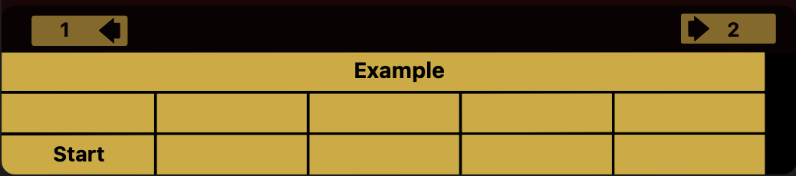

# Presets of Calc-U-59

What a preset is, how it loads, its steps and how it waits are the
family's: [Presets](../../../library/help/06-presets.md). This part shows
what Calc-U-59 adds: its header keys, its sections for program memory,
data registers, the partition and the cue card, the magnetic cards, and
its examples. Every key and step is listed in the
[preset sections of this product](10-preset-sections.md). New to presets?
The [preset tutorial](06-preset-tutorial.md) builds one up step by step,
with a file to download at each step.

A preset is a plain UTF-8 text file ending in `.ti59`, `.ti58` or `.ti58c`;
the ending does not choose the model, `model:` does. Load one with
**File ▸ Load Preset…** (the **Preset** button on the iPhone, the iPad and
in the browser's portrait layout), drop it on the window, or choose an
example under **Examples ▸**.

## An example

```yaml
format-version: 2
model: TI-59
preset-name: Example
description: A program, a register, a cue card and the printer
slot-1: { name: ML }        # the Master Library module
printer: PC-100C

partition: 799.19           # 800 steps, 20 data registers: 2 Op 17

program:
  keycodes: |
    000 76 LBL
    001 11 A
    002 89 π
    003 95 =
    004 91 R/S

data:
  00: 3.141592653589793     # π; RCL 00 shows 3.141592654

cue-card:
  title: Example
  A: Start

keys:
  - regular-speed:
  - key: 3 A
  - wait: 2s
  - key: RCL 0 0
```



- `model:` is `TI-59`, `TI-58` or `TI-58C`.
- `slot-1:` is the Solid State ROM module, by its ID: `{ name: ML }` for
  the Master Library ([Solid State ROM modules](09-modules.md)). Without
  it the slot is empty.
- `printer: PC-100C` attaches the printer. Without it there is none.
- A load always builds a new calculator from a cold boot; nothing of the
  calculator that ran before is kept.

## The sections

| Section | What it does |
|---|---|
| `partition:` | The split between program steps and data registers, written as the display shows it: `799.19` is the last step 799 and 20 registers. Until it, the partition is the one after switching on: 479.59 on the TI-59, 239.29 on the TI-58 and TI-58C |
| `program:` | The program memory, as keycodes, the codes the calculator shows in learn mode, not the keys' positions: `keycodes: \|` inline, or `file:` a [keystroke program file](10-keystroke-programs.md). A line is either compact (two-digit keycodes, as many as wanted) or a listing as the PC-100C prints it (step, keycode, mnemonic). Only the steps listed are written |
| `data:` | Data registers, `NN: value`, at the calculator's full precision of 13 digits. On the TI-58C, `H00` to `H03` are its four extra cells |
| `cue-card:` | The cue card fitted above the keys ([Cue cards](09-cue-cards.md)) |
| `keys:` | The steps: keys, waiting, checks, and the steps below |

Sections are carried out in file order, and each may come several times.
A `program:`, `data:` or `cue-card:` section after a `keys:` section
changes the calculator in the middle of the script, as if you had typed
the changes in, so that one preset can play a whole session:

```yaml
keys:
  - key: A                  # it runs and stops
program:
  keycodes: |
    017 01                  # then step 017 changes …
data:
  05: 2.5                   # … and register 05
keys:
  - key: A                  # run again
```

## Keys

A `key:` step presses keys by their **key IDs**: the label on the key when
it is one plain word (`RCL`, `SBR`, `A`, `7`), otherwise the name the
PC-100C prints for it (`STF`, `IFF`). A second function is written by its
own name, which presses 2nd and then the key: `Pgm`, `2nd Pgm` and
`2nd LRN` all press 2nd, LRN. Key IDs are separated by spaces and read in
any case; `1 2` is two keys, `12` is an error. The table of every key ID
is in [Preset sections](10-preset-sections.md).

Keycodes (in `program:`) and key IDs (in `key:`) are different things:
digit 5 is keycode `05`, and the key **5**.

## Checking the display

`expect: <number>` and `not-expect: <number>` compare the number with the
calculator's working register X at its full precision of 13 digits,
whatever the display format shows: after **π**, `expect: 3.14159265359`
passes and `expect: 3.141592654` fails. Blinking is not tested.

## Magnetic cards in a preset

On the TI-59 a preset can feed cards as their owners did, one after
another in a written-down order:

- `- card: { name: Results }` pushes side 0 of a saved card through the
  reader, as you would by hand; `{ name: Results, side: 1 }` side 1;
  `{ file: … }` names a card file.
- `- arm: { name: Results }` fits a card for you to feed with a corner.
- The header key `magnetic-cards:` defines **in-file cards**, which live
  only while the preset is loaded and are addressed with `mem:`. A side
  replaces its whole bank, as a real card does; what a program writes to
  an in-file card is kept until the next load or model switch.
- `- saveas: { card: Bank4, as: live, name: Bank 4 }` saves an in-file
  card as a card of your own.

```yaml
magnetic-cards:
  - card-name: Bank4
    sides:
      0:
        bank: 4
        data:
          00: 12
          01: 3.5
keys:
  - card: { mem: Bank4 }     # read bank 4, as at the start of a session
  - key: A                   # run
```

A step that makes the calculator wait for a card (`- key: 1 2nd Write`)
finishes when it waits, so the next step, `card:`, feeds it. A card a
preset feeds is fitted after it has passed. A `{ name: }` or `{ file: }`
card that does not exist refuses the preset. More on cards:
[Magnetic cards](04-magnetic-cards.md).

## Calc-U-59's steps

Besides the family's steps:

| Step | What it does |
|---|---|
| `card:`, `arm:`, `saveas: { card: … }` | magnetic cards, above (TI-59) |
| `printer-trace: on` / `off` | sets the PC-100C's TRACE switch; off unless a preset says so |
| `pause: program` / `cpu`, `pause-on-start:`, `step:`, `resume:` | the debugger ([Debugger](07-debugger.md)) |
| `debug-panel: calculator` / `cpu` / `log` | shows that tab of the debug panel |

Calc-U-59 has no `type:` step: the calculator has no text to type.

## Startup presets and examples

**Settings ▸ Startup presets** has a row for the TI-59, the TI-58 and the
TI-58C ([Settings of this product](08-settings.md)). A TI-58C built from a
startup preset starts from a cold boot and leaves the constant memory file
alone ([Constant memory](09-constant-memory.md)).

The examples under **Examples ▸** are in three groups: Diagnostics (the
diagnostic programs of the TI-59 and TI-58, a RAM test), Programs (the sum
of 1 to N, the display's characters, fast mode under single steps) and
Printer pictures (four pictures the PC-100C prints). Each model's row of
Startup presets also offers the startup preset Calc-U-59 bundles for it. Open an
example to see how it is written. More programs, many of them historic, are in the
[TI-59 Software Collection](https://calc-u.org/59/software/).

## A 2.3.0 preset

A preset written for Calc-U-59 2.3.0 (`MODEL:`, `PROGRAM:`,
`KEYSTROKES:` with matrix codes) is refused with a hint: it is upgraded
by hand to format 2. How each line of the old format is written now is in
[Preset sections](10-preset-sections.md).
