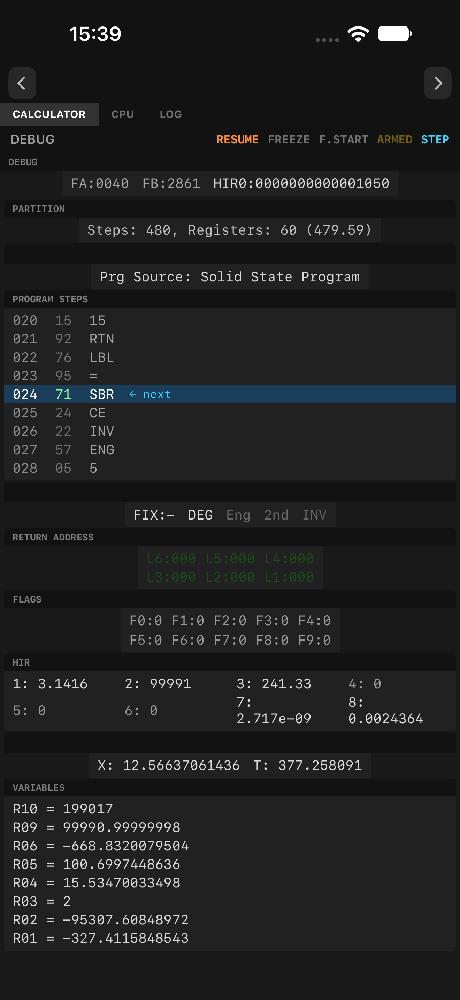
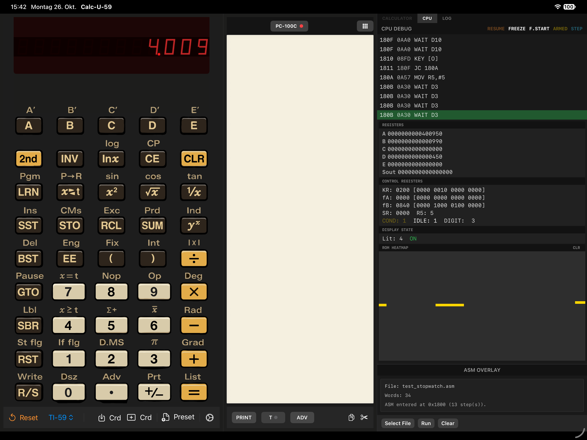

# Debugger of Calc-U-59

Running and paused, pause, step and resume, traces and the debugger
steps of a preset are the family's: [Debugger](../../../library/help/07-debugger.md).
This part shows Calc-U-59's **debug panel** and its two levels:
`program`, one step of a keystroke program, and `cpu`, one instruction
of the calculator's processor.

The debug panel stands beside the calculator and the paper on macOS,
Windows and Linux, on the iPad in landscape and in the browser's wide
layout; in portrait on the iPhone and the iPad it is a page of its own
(Settings ▸ Layout ▸ Debug Page in Portrait). It has three tabs: **CALCULATOR**, **CPU** and
**RUN LOG**.

| Tab | Shows | Use it for |
|---|---|---|
| CALCULATOR | the program around the next step, the registers, the flags, at the level `program` | stepping through your own program |
| CPU | the processor's last instructions, at the level `cpu` | following the ROM's own logic one instruction at a time |
| RUN LOG | the log, the dumps, the TRACE button | recording a trace to study afterwards |

## The run-control buttons

The CALCULATOR and the CPU tab each have a row of buttons in their
header:

- **FREEZE** pauses the calculator: in the CALCULATOR tab at the next
  program step, in the CPU tab at the next instruction.
- **STEP** carries out one step and pauses again: in the CALCULATOR tab
  one program step, as SST does, a jump (GTO, SBR, RTN, a condition)
  completed in the step that makes it; in the CPU tab one instruction.
  Hold it to repeat.
- **RESUME** lets the calculator run on.
- **FREEZE ON START** (**F.START** when the panel is narrow) arms a pause
  at the next start and then reads **ARMED**; press ARMED to cancel. In
  the CALCULATOR tab it pauses before the first step of a program run
  (R/S, a label key, anything that starts a program). In the CPU tab it
  pauses when the calculator leaves its keyboard scan loop: when you
  press a key, or at a Cold boot or a Reset.

FREEZE and FREEZE ON START can be used while the calculator runs. Once it
is paused, RESUME and STEP work in the tab that paused it.
**Machine ▸ Resume** resumes it whatever paused it.

## CALCULATOR tab

The CALCULATOR tab shows the calculator between two program steps:

- the program steps around the current one, which is marked as the next
  to run (**← next**) or as running; a jump moves the listing to its
  target, since this is no trace;
- the partition, where the running program comes from (your program,
  the ROM's own, the module), and the return addresses;
- **X:** and **T:**, the working value and the t register with all 13
  digits, and the registers of pending operations; when X holds no
  number (while stepping a fast-mode program, say), the raw register is
  shown in amber;
- the flags, the display format and the angle mode; **DEBUG** shows the
  flag registers FA and FB and **HIR0:**, the whole status register;
- the calculator's own 16 registers, and the data registers that are not
  zero, on the TI-58C also H00 to H03.

While the calculator is paused the tab also has the whole listing of the
program that runs. Fast mode is shown while a program runs in it
([Fast mode](09-fast-mode.md)).



## CPU tab

The CPU tab lists the instructions the processor carried out, each with
its address, its text and the registers. Each entry **already ran**: the
newest 32 while the calculator runs, up to 1024 and the next instruction
while it is paused, so you can scroll back. Jumps, subroutine calls and
the ROM's page changes show in the addresses.

- **ROM HEATMAP** shows how often each ROM address ran; **CLR** starts it
  over. It also starts over at a Reset, a model switch, and when the
  panel comes into view or you switch to the CPU tab.
- **ASM OVERLAY**: **Select File** puts a small machine-code program, an
  ASM overlay, over the ROM's addresses 1800 to 1FFF; **Run** enters it
  at 1800; **Clear** takes it away again and resets the calculator when
  it was running. While an overlay runs, the CALCULATOR tab cannot be
  chosen; FREEZE, STEP and RESUME of the CPU tab work on its instructions.
  A Cold boot, a model switch or a preset removes the overlay. The format
  and the examples: [ASM overlay](10-asm-overlay.md).
- A TEST instruction shows the flag it set, while the following JUMP
  shows the condition restored after it (usually 1), because the state
  is taken after each instruction. That is expected.



## RUN LOG tab

- **SCOM**, **Memory**, **Prog** and **Vars** write the calculator's own
  registers, its memory, the program or the data registers into the log;
  the bin button empties the tab's view.
- **RUN LOG** steps the log's level through Off, Info and Debug (a grey,
  orange or red dot). At Info the log also shows how a preset is carried
  out, each step as it is done; at Debug the calculator logs each write
  to its registers and memory as well, which is mostly for the developer.
- **TRACE** starts and ends a trace of the processor's instructions.

## Traces

A trace started with the TRACE button is named after the model:
`CALCU59_TRACE.bin`, `CALCU58_TRACE.bin` or `CALCU58C_TRACE.bin`. It goes
into the trace folder ([the family's rules](../../../library/help/07-debugger.md#traces)):

| System | Trace folder |
|---|---|
| iPhone, iPad | the app's own storage (Application Support), or its iCloud folder when Settings ▸ Tracing ▸ Save Location says iCloud |
| macOS, Windows, Linux | the save folder, unless Settings ▸ Tracing ▸ Trace folder names another |
| the browser | a trace that ended is offered to download, in the wide layout |

Only one trace runs at a time, the button's or a preset's; it holds the
processor's instructions and the gaps between them. When the file reaches
the size limit (Settings ▸ Tracing ▸ Maximum file size), the trace ends
and a notice says so.

To read a trace, download or clone the repository
[tinue/calc-u](https://github.com/tinue/calc-u) on a computer with
Python, and in `products/calc-u-59/` run:

```sh
python3 tools/read_trace.py --clean --skip-repeating CALCU59_TRACE.bin > CALCU59_TRACE.txt
```

The script needs the files next to it (the disassembler and its table of
mnemonics), so it cannot be downloaded alone. The binary file can be
large (190 MB for a long session), the text much smaller, because the
script folds repeated loops such as the keyboard scan loop.

## Good to know

- **Stepping through the reset routine:** in the CPU tab press FREEZE ON
  START, then **Machine ▸ Cold boot** (or Reset). The calculator pauses at
  the first instruction of the ROM's start-up; STEP walks through it.
- **A key after FREEZE ON START (CPU) seems lost:** the ROM sees a key
  only for a very short time, which has passed when you resume. Use a
  trace instead: it records without stopping the calculator.
- **Only one FREEZE ON START** is armed at a time; arming it in one tab
  disarms the other.
- **In a preset**, `pause: program` or `pause: cpu`, `pause-on-start: program` / `cpu` / `off`,
  `step: { level: cpu, count: 5 }` and `resume:` do what the buttons do,
  and `debug-panel: cpu` shows that tab
  ([Presets of this product](06-presets.md)).
