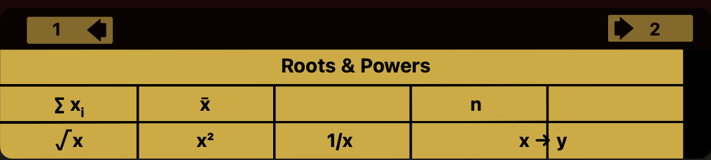

# Cue cards

A **cue card** is the card in the window above the top row of keys. It
labels the user-defined keys **A** to **E** and **A′** to **E′** for the
program that is loaded, as the cards of the real calculator did. Fitting
a cue card changes nothing in the calculator.

## Three kinds

| Kind | Comes from | Looks like |
|---|---|---|
| **Stand-alone cue card** | a preset's `cue-card:` section; on the TI-58C, the constant memory file | a plain card written by hand |
| **Magnetic card** (TI-59) | a card file, or an in-file card of a preset ([Magnetic cards](04-magnetic-cards.md)) | a card with a magnetic strip; each top corner shows the bank of its side |
| **Module cue card** | the module in the slot, one per library program ([Solid State ROM modules](09-modules.md)) | pre-printed, in gold |

The window shows one card at a time. Your **own card** is the
stand-alone cue card or the magnetic card fitted last; a new one takes
the place of the one before. While a library program is selected
(**2nd Pgm nn**), its module cue card lies over your own card, and your
card shows again when no library program is selected.

- A preset builds a new calculator, which has no card until the preset
  fits one.
- A Reset, a power cycle and a Cold boot keep the fitted card.
- A magnetic card without a cue card of its own shows a plain card
  titled with its name.
- A magnetic card always carries its own cue card, never the preset's
  `cue-card:`.

## Writing a cue card

A cue card is a block of keys, in a preset's `cue-card:` section, in an
in-file card of `magnetic-cards:` or in a card file:

```yaml
cue-card:
  title: Roots & Powers
  A: \sqrt x
  B: x^{2}
  C: 1/x
  D: x \to y
  E: \blank
  "A'": \sum x_{i}
  "B'": \xbar
  "C'": n
```



| Key | Value |
|---|---|
| `title` | the headline |
| `A` … `E` | the labels of the A–E row |
| `A'` … `E'` | the labels of the A′–E′ row, written in quotes: `"A'": text` |
| `row-1` | one line of text in place of the A′–E′ labels |
| `row-2`, `row-2-r` | one line of text in place of the A–E labels; `row-2-r` stands right of it |
| `row-1-align` | `left`, `center` (the default) or `right` |
| `row-2-align`, `row-2-r-align` | `left` (the default), `center` or `right` |
| `style` | `none` (the default) or `button`: a box around the row's text |
| `pencil-color` | `black` (the default), `pencil` or `sharpie`, for the whole card |

- `\blank` as a label is an empty cell that the label before it spans
  into: `D: x \to y` and `E: \blank` give one label over D and E. An empty
  label is an empty cell nothing spans into.
- A label row shows only while its row text is empty.
- Shortcuts give the signs real cards used: `\sqrt` √, `\xbar` x̄, `\to` →,
  `\sum` ∑, `\pi` π, `^{2}` ², `_{i}` ᵢ and more; the whole table is in
  [Media files](10-media-files.md).
- A text that contains `: ` or ` #`, or starts with `[`, `{` or a quote,
  is written in quotes.

The tutorial builds a card step by step
([Preset tutorial](06-preset-tutorial.md)). To change the card of a saved
magnetic card, edit the `cue-card:` block of its card file in a text
editor; the change shows the next time the card is fitted.
